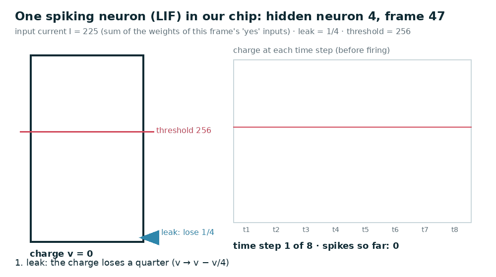
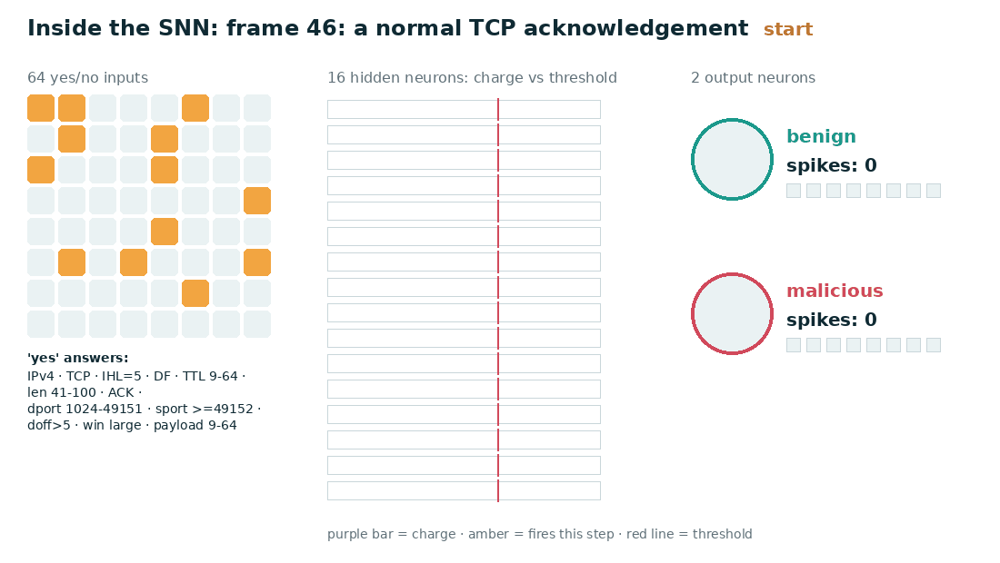
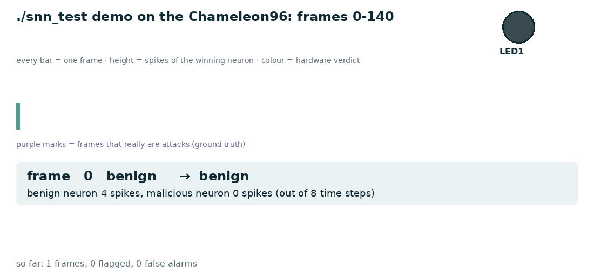

# What `./snn_test demo` shows, and what LIF means

The demo on the Chameleon96 replays frames 0–140 of the test recording through the real FPGA, one per line. This
page explains every column, the neuron model behind the numbers (LIF), and the interesting frames. The animations
are computed from the real trained weights and the real frames with the hardware's exact integer arithmetic. They
match the board output for all 600 frames.

## 1. Reading one line

```
frame  47  syn_flood   -> MALICIOUS  (benign neuron  0 spikes, malicious neuron  7)
  │     │      │              │                    │                          │
  │     │      │              │                    └ how often the "benign" output neuron fired in the 8 time steps
  │     │      │              └ the FPGA's verdict for this frame              └ same for the "malicious" neuron
  │     │      └ what the frame really is (the label from the traffic generator, i.e. the ground truth)
  │     └ position in the 600-frame recording
```

- The FPGA never sees the label; it only gets the frame's header bytes. The label is printed so you can check the
  verdict.
- Each output neuron can fire at most once per time step, so the counts go from 0 to 8.
- **The neuron with more spikes wins.** On a tie, the one with more charge left wins.
- **LED1** lights for about 0.17 s on every MALICIOUS line, so during the flood it flickers or stays lit.

## 2. What LIF is: the neuron in our chip

*The neuron datapath, animations and alternative neuron models: `docs/neuron_hdl.md`.*

**LIF = Leaky Integrate-and-Fire.** It is the simplest realistic model of a biological neuron, and it's what each of
our 18 neurons (16 hidden + 2 output) computes. Think of a bucket with a small hole:

| step | name | what happens | in hardware |
|---|---|---|---|
| 1 | **Leak** | the bucket loses a quarter of its water | `v ← v − (v >>> 2)`: a shift (just wiring) and a subtraction |
| 2 | **Integrate** | water pours in: the input current I | `v ← v + I`: one adder |
| 3 | **Fire** | if the water reaches the line, the bucket tips: a **spike**, and it starts empty | `if v ≥ 256: spike = 1, v ← 0`: a comparator and a multiplexer |

The three steps repeat 8 times (8 **time steps**) for every frame. A strong input crosses the line often, so it
fires many spikes; a weak or negative input never fires. **The number of spikes carries the information.**



*Hidden neuron 4 while frame 47 is classified. Its input current is 225, which is below the threshold of 256, so the
first step doesn't fire. The charge then builds up (169 left after the leak + 225 = 394) and it fires, resets, and
repeats: 4 spikes in 8 steps.*

Where the input current comes from: each of the 64 yes/no questions about the header has a learned weight for each
neuron. The current is the sum of the weights of the questions answered "yes". It's computed once per frame. The
hidden neurons' spikes then feed the two output neurons the same way, through a second set of weights.

## 3. One frame through the whole network



| | frame 46: normal TCP acknowledgement | frame 47: first SYN-flood packet |
|---|---|---|
| "yes" answers | TCP, ACK, TTL 9–64, length 41–100, TCP options (doff > 5), high source port | TCP, **SYN**, **TTL > 128**, **length ≤ 40**, **no TCP options (doff = 5)**, well-known destination port |
| hidden layer | few neurons fire | different neurons fire, many of them every step |
| output | benign neuron 4 spikes, malicious 0 | benign 0, **malicious 7** |
| verdict | release the frame | **erase the frame**, LED1 lights |

A bare 40-byte SYN with a very high TTL and no options is what flood tools such as `hping3` send. Real clients add
TCP options and use a normal TTL. The network learned this difference from the training data.

## 4. The whole demo



| frames | what you see | why |
|---|---|---|
| 0–46 | all benign; the benign neuron fires 4–8 times, the malicious neuron never | normal web, DNS and ping traffic |
| 47 | **MALICIOUS** at once (0 : 7) | the header looks like a flood tool's SYN; this works even before the "many SYNs lately" questions turn on |
| 48–57 | MALICIOUS (0 : 7 or 8) | the flood continues; from frame 53, ≥ 8 SYNs among the last 32 frames, so the rate questions say "yes" too |
| 58, 59, 62, 76, … | **benign inside the flood** | normal packets mixed into the attack are still let through: every frame is judged on its own header, not blocked by association |
| 94, 116 | MALICIOUS with only 5 or 4 spikes | weaker evidence, but the malicious neuron still wins |
| 114 | benign, **5 : 1** | a normal client SYN during the flood: the rate questions add 1 malicious spike, but its header (options, TTL 64) looks normal |
| **128** | **benign, 4 : 2: the only miss** | a flood SYN that imitates a real client (TCP options, TTL 9–64, high source port). The Python model makes the same call, so the hardware is right to copy it |
| 129–140 | flood continues, flagged | |

In total, frames 0–140 hold 71 flood frames. The FPGA flags 70 of them, with **0 false alarms**, and every line is
identical to the simulation.

## 5. Why this is a good result, and what it isn't

**What it is:**
- The real FPGA silicon computes exactly what the trained model and the RTL simulations compute.
- The decision is per packet and based only on the header.
- Normal packets keep flowing during an attack.

**What it isn't yet:**
- Proof of accuracy on real-world traffic. The frames and the training data are synthetic.
- A real attack on the board. The next step is `snn_fw.ko`, which classifies live WiFi traffic so you can flood the
  board from the laptop (`docs/cv96_run_snn_test.md` §7).

*Regenerate the animations after retraining:* `python3 docs/slides/make_gifs.py` (needs Pillow).
