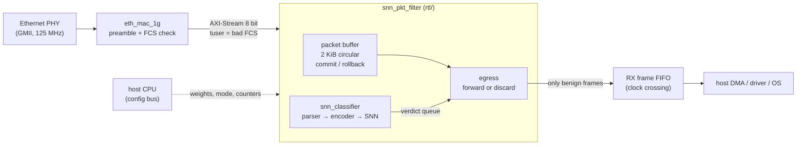
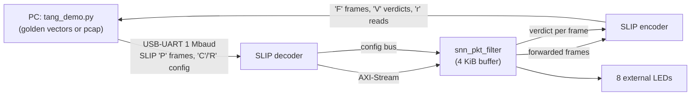
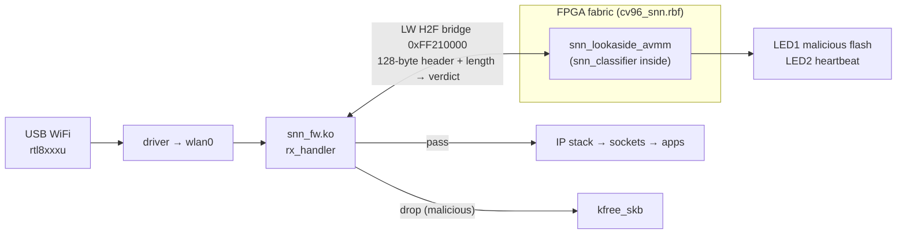

# Design document: SNN packet firewall

A spiking neural network (SNN) that classifies every received Ethernet frame as **benign** or **malicious** from
its headers, in hardware, and discards malicious frames before the operating system processes them.

One classification engine (`rtl/snn_classifier.v`) is used in three deployments:

| deployment | wrapper / top | where a malicious frame is stopped |
|---|---|---|
| **ASIC** (Cadence 90 nm; sky130 in CI) | `snn_pkt_filter_asic` = `snn_pkt_filter` in-line in the NIC receive path; fused into a MAC in `eth_mac_1g_snn_fifo` | inside the NIC, before the host FIFO / DMA: the OS never sees it |
| **Tang Nano 9K** (Gowin GW1NR-9) | `tang9k_snn_top`: the same `snn_pkt_filter`, with a PC + USB-UART standing in for the PHY | inside the FPGA, before the frame goes back to the PC |
| **Chameleon96** (Cyclone V SoC, Linux) | `snn_lookaside_avmm` on the HPS lightweight bridge + kernel module `snn_fw.ko` | in the Linux kernel, right after the WiFi driver, before the IP stack |

---

## 1. System architecture

### 1.1 In-line (ASIC / NIC): the target architecture



### 1.2 Tang Nano 9K: the in-line datapath with a UART instead of a PHY



### 1.3 Chameleon96: look-aside accelerator for Linux

The Chameleon96 has no FPGA-side Ethernet, so the network adapter (TP-Link USB WiFi) is on the HPS (ARM) side. The FPGA
can only see a frame after Linux has received it.



### 1.4 Inside the engine (all deployments)

```
                 beat_data[7:0], beat_valid, beat_last
                               │
            ┌──────────────────┼──────────────────────────────── snn_classifier ─┐
            │                  ▼                                                  │
            │  ┌────────────┐ fields ┌───────────────┐ spikes[63:0] ┌──────────┐  │
            │  │ pkt_parser │───────►│ spike_encoder │─────────────►│ feature  │  │
            │  │ Eth/VLAN/  │  done  │ 61 header     │  spk_valid   │ FIFO (4) │  │
            │  │ IPv4/L4    │        │ features +    │              └────┬─────┘  │
            │  └────────────┘        │ rate window   │                   │        │
            │                        │ (SYN, ping)   │                   ▼        │
            │                        └───────────────┘           ┌──────────────┐ │
            │  config regs: TH1 TH2 TIMING B2 W2[16] ───────────►│   snn_core   │ │
            │  W1 write port (64 × 16 × int8) ──────────────────►│ 64 → 16 → 2  │ │
            │                                                    │ LIF, T = 8   │ │
            │                                                    └──────┬───────┘ │
            └───────────────────────────────────────────────────────────┼─────────┘
                                                                        ▼
                                            v_valid, v_mal, v_cnt0, v_cnt1, v_tag
```

### 1.5 Life of one frame (in-line)

| cycle | what happens |
|---|---|
| 0 … L−1 | bytes enter, one per clock. They are written into the buffer and observed by `pkt_parser` at the same time |
| L | `tlast` beat: the frame is **committed** (kept) or **rolled back** (bad FCS, didn't fit, or classifier queue full) |
| L+1 | `pkt_parser.done` |
| L+2 | `spike_encoder.spk_valid`: the 64-bit spike vector enters the feature FIFO |
| + (active inputs) + T + 6 | `snn_core` verdict. Typically ~25–40 cycles, because only the inputs that are 1 are visited |
| then | egress pops the verdict. Benign: the stored bytes are streamed to `m_axis`. Malicious (`drop_en = 1`): the bytes are skipped |

Store-and-forward latency ≈ frame length + ~40 cycles. Minimum-size frames are sustained at 1 Gb/s (test T8).

---

## 2. Signals

Clocking for every block: a single clock `clk` with a synchronous, active-high reset `rst`. `reset` on the Avalon
wrappers is the same; the Tang Nano 9K uses the active-low button `rst_n`.

### 2.1 `snn_pkt_filter_asic` / `snn_pkt_filter`: the ASIC top

| signal | dir | width | meaning |
|---|---|---|---|
| `clk` | in | 1 | 125 MHz in the ASIC (the GMII byte clock of 1 GbE) |
| `rst` | in | 1 | synchronous reset: clears pointers, counters, CTRL, thresholds, W2/B2 and the rate window (**not** W1) |
| `s_axis_tdata` | in | 8 | frame byte from the MAC |
| `s_axis_tvalid` | in | 1 | byte valid. A frame is a burst of valid beats with no gaps |
| `s_axis_tlast` | in | 1 | last byte of the frame |
| `s_axis_tuser` | in | 1 | with `tlast`: the MAC found a bad FCS, so drop the whole frame |
| `s_axis_tready` | out | 1 | **always 1**: a MAC cannot be stalled. Overflow is handled by dropping whole frames |
| `m_axis_tdata` | out | 8 | forwarded frame byte to the host side |
| `m_axis_tvalid` | out | 1 | byte valid |
| `m_axis_tready` | in | 1 | host side can accept (back-pressure is allowed here) |
| `m_axis_tlast` | out | 1 | last byte of a forwarded frame |
| `m_axis_tuser` | out | 1 | always 0 (only good frames are ever forwarded) |
| `cfg_wr` | in | 1 | config write strobe (one cycle) |
| `cfg_rd` | in | 1 | config read strobe; `cfg_rdata` is valid one cycle later |
| `cfg_addr` | in | 10 | word address, see §3.1 |
| `cfg_wdata` | in | 32 | write data |
| `cfg_rdata` | out | 32 | read data (registered) |
| `verdict_valid` | out | 1 | one-cycle pulse per classified (committed) frame, in arrival order |
| `verdict_mal` | out | 1 | with `verdict_valid`: 1 = malicious. Used for an IRQ, an LED or a counter |

Parameters: `BUF_AW` (buffer = 2^BUF_AW bytes; 11 in the ASIC, 12 on the FPGAs), `FEAT_DEPTH` = 4, `VERD_DEPTH` = 16,
`N_HID` = 16, `TH1_INIT` = 256, `TH2_INIT` = 128, `T_INIT` = 8, `LEAK_INIT` = 2, `DROP_BAD_FRAME` = 1.

Internal signals worth probing (RTL only): `wr_ptr`, `wr_commit`, `rd_ptr` (buffer pointers), `drop_cur` (current frame
being dropped), `verd_push` / `c_mal` / `c_cnt0` / `c_cnt1` / `c_tag` (verdict as produced, `c_tag` = frame
length), `e_run` / `e_fwd` (egress busy / forwarding), `st_*` (counters).

### 2.2 `snn_classifier`: the shared engine

| signal | dir | width | meaning |
|---|---|---|---|
| `beat_data`, `beat_valid`, `beat_last` | in | 8, 1, 1 | the byte stream (in-line: every ingress beat; look-aside: the header-window bytes) |
| `frm_commit` | in | 1 | sampled with `beat_last`: 1 = classify this frame, 0 = it was dropped upstream, forget it |
| `frm_len_ovr` | in | 1 | 1 = use `frm_len` as the frame length (look-aside sends only ≤128 bytes); 0 = count beats |
| `frm_len` | in | 16 | true frame length when `frm_len_ovr` = 1 |
| `frm_tag` | in | 13 (param) | opaque tag returned with the verdict (in-line: the frame length; look-aside: the 8-bit software tag) |
| `can_commit` | out | 1 | 1 = a frame ending now can be accepted (feature FIFO not full) |
| `v_valid` | out | 1 | verdict available |
| `v_ready` | in | 1 | consumer takes the verdict |
| `v_mal` | out | 1 | 1 = malicious |
| `v_cnt0`, `v_cnt1` | out | 4, 4 | spikes of output neuron 0 ("benign") and 1 ("malicious") over the T time steps |
| `v_tag` | out | 13 | the frame's `frm_tag` |
| `cfg_wr`, `cfg_rd`, `cfg_addr`, `cfg_wdata`, `cfg_rdata` | | | config bus, as in §2.1 |

### 2.3 `pkt_parser`: header field extraction

Inputs are the beat stream (`beat_data`, `beat_valid`, `beat_last`). Outputs are valid when `done` pulses (one cycle
after `beat_last`) and stay valid until the next frame starts. All fields are cleared at the start of every frame, so
a truncated frame reads 0 in its missing fields, exactly like the model.

| output | width | meaning |
|---|---|---|
| `done` | 1 | fields are valid (one-cycle pulse) |
| `flen` | 16 | frame length in bytes (saturating) |
| `ethertype` | 16 | EtherType, after one optional 802.1Q VLAN tag |
| `vlan` | 1 | a VLAN tag was present |
| `ihl` | 4 | IPv4 header length (in 32-bit words) |
| `tot_len` | 16 | IPv4 total length |
| `df`, `mf` | 1, 1 | Don't-Fragment / More-Fragments flags |
| `foff` | 13 | fragment offset |
| `ttl` | 8 | time to live |
| `proto` | 8 | IP protocol (6 TCP, 17 UDP, 1 ICMP) |
| `src_ip`, `dst_ip` | 32, 32 | addresses |
| `has_l4` | 1 | the L4 header start lies inside the frame |
| `sport` | 16 | source port. For ICMP, `sport[15:8]` holds the ICMP type |
| `dport` | 16 | destination port |
| `doff` | 4 | TCP data offset |
| `tflags` | 8 | TCP flags (bit 0 FIN, 1 SYN, 2 RST, 3 PSH, 4 ACK, 5 URG) |
| `win` | 16 | TCP window |

### 2.4 `spike_encoder`: fields → 64 spikes

Inputs: all `pkt_parser` outputs, plus `commit` (the frame was accepted; only accepted frames update the rate window).
Outputs: `spk_valid` (one-cycle pulse) and `spikes[63:0]`. Parameters: `RATE_WIN` = 32 frames, `RATE_T1` = 8,
`RATE_T2` = 16. Table of all 64 features: §4.

### 2.5 `snn_core`: the spiking network

*The neuron datapath, animations and alternative neuron models: `docs/neuron_hdl.md`.*

| signal | dir | width | meaning |
|---|---|---|---|
| `th1`, `th2` | in | 16, 16 | firing thresholds of the hidden and output layers |
| `t_steps` | in | 4 | number of time steps T (1–15, default 8) |
| `leak` | in | 2 | leak shift: v loses v >> leak per step |
| `b2` | in | 16 | output biases {b_o1, b_o0}, int8 each |
| `w2` | in | 256 | hidden → output weights, 16 neurons × 2 outputs × int8 |
| `w1_we`, `w1_row`, `w1_lane`, `w1_wdata` | in | 1, 6, 2, 32 | W1 write port: input `row`, neurons 4·lane … 4·lane+3, one int8 per byte |
| `in_valid` / `in_ready` | in / out | 1 | handshake for a new spike vector (ready = idle) |
| `in_spikes`, `in_tag` | in | 64, 16 | input spikes and tag |
| `out_valid` / `out_ready` | out / in | 1 | verdict handshake |
| `out_mal`, `out_cnt0`, `out_cnt1`, `out_tag` | out | 1, 4, 4, 16 | verdict, output spike counts, tag |

Internal: `state` (IDLE → ACC → LIF → OUT), `pend` (input spikes still to visit), `acc[h]` (hidden input current),
`v1[h]` / `v2[o]` (membranes), `cnt[o]` (output spike counts).

### 2.6 `sync_fifo`

`wr_en`, `wr_data`, `rd_en`, `rd_data` (show-ahead), `empty`, `full`, `count`; parameters `W`, `DEPTH` (power of 2).
Used for the feature queue (64 spikes + tag), the verdict queue, and the look-aside verdict queue.

### 2.7 Board tops and wrappers

**`tang9k_snn_top`** (`fpga/tang9k/`; Tang Nano 9K on the custom perfboard with an FTDI UART header and 8 LEDs, constraints `tang9k.cst`)

| signal | pin | meaning |
|---|---|---|
| `clk` | 52 | 27 MHz crystal |
| `rst_n` | 3 | S1 button, reset (active low, 1.8 V bank) |
| `uart_rx` | 31 | from the external FTDI header, FTDI TX → FPGA (PC → FPGA), 1 Mbaud 8N1 |
| `uart_tx` | 32 | to the FTDI header, FPGA → FTDI RX |
| `leds_ext[7:0]` | 75, 74, 73, 72, 71, 70, 51, 53 | external LEDs on the perfboard, active high (parameter `LED_ACTIVE_HIGH`): 0 malicious flash, 1 heartbeat, 2 frame forwarded, 3 frame blocked, 4 UART RX activity, 5 config written, 6 UART TX activity, 7 under attack (≥ 4 of the last 8 verdicts malicious) |

Parameter `CLKS_PER_BIT` = 27 (27 MHz / 1 Mbaud). The testbench uses 4 to keep simulations short.

**`snn_lookaside_avmm`** (Chameleon96, inside `cv96_snn.rbf`)

| signal | dir | meaning |
|---|---|---|
| `clk`, `reset` | in | 100 MHz `h2f_user0_clk`, reset |
| `avs_address[10:0]` | in | word address on the lightweight HPS-to-FPGA bridge (base 0xFF210000) |
| `avs_write`, `avs_writedata[31:0]` | in | write |
| `avs_read`, `avs_readdata[31:0]` | in / out | read (read latency 1, no waitrequest) |
| `irq` | out | level: a verdict is waiting (if CTRL.irq_en). Goes to f2h_irq0 #1 |
| `leds[1:0]` | out | [0] malicious-frame flash → LED1, [1] heartbeat → LED2 |

**`snn_fw_avmm`**: the in-line filter behind an Avalon slave, for HPS bring-up without a PHY. Same Avalon signals,
plus `avs_waitrequest`.

**`eth_mac_1g_snn_fifo`**: verilog-ethernet's `eth_mac_1g_fifo` with `snn_pkt_filter` inserted in the RX path
(in the `rx_clk` domain, after FCS check, before the clock-crossing FIFO). The standard MAC ports are
unchanged (`gmii_*`, `rx_axis_*`, `tx_axis_*`, status, `cfg_ifg` …). The added ports are `snn_cfg_wr`,
`snn_cfg_rd`, `snn_cfg_addr`, `snn_cfg_wdata`, `snn_cfg_rdata`, `snn_verdict_valid` and `snn_verdict_mal`, with the
same meaning as in §2.1.

---

## 3. Register maps (32-bit words, word addresses)

### 3.1 In-line filter (`snn_pkt_filter`, ASIC, Tang Nano 9K, MAC)

| addr | name | access | meaning |
|---|---|---|---|
| 0x000 | CTRL | RW | [0] `drop_en` (reset 1): discard malicious frames. [1] `bypass`: forward everything |
| 0x001 | TH1 | RW | [15:0] hidden threshold (reset 256) |
| 0x002 | TH2 | RW | [15:0] output threshold (reset 128) |
| 0x003 | TIMING | RW | [3:0] T time steps (reset 8), [5:4] leak shift (reset 2) |
| 0x004 | B2 | RW | [7:0] bias output 0, [15:8] bias output 1 (int8, reset 0) |
| 0x010–0x01F | W2[h] | RW | [7:0] w(h → out0), [15:8] w(h → out1) (int8, reset 0) |
| 0x020 | frames committed | R | accepted into the buffer |
| 0x021 | dropped at ingress | R | bad FCS, too big, or no room |
| 0x022 | malicious | R | classified malicious |
| 0x023 | forwarded | R | sent to the host |
| 0x024 | blocked | R | discarded as malicious |
| 0x025 | last verdict | R | [8] mal, [7:4] cnt1, [3:0] cnt0 |
| 0x100 + 4·row + lane | W1 | W | input `row` (0–63) → neurons 4·lane … 4·lane+3, one int8 per byte (byte k = neuron 4·lane+k) |

Unmapped addresses read 0. W1 reads 0 (it is a write-only memory).

### 3.2 Look-aside accelerator (`snn_lookaside_avmm`, Chameleon96)

| addr | name | access | meaning |
|---|---|---|---|
| 0x000 | CTRL | RW | [0] `irq_en` |
| 0x001–0x004, 0x010–0x01F, 0x100–0x1FF | | | classifier config, same as §3.1 |
| 0x020 | submitted | R | frames submitted |
| 0x021 | rejected | R | SUBMIT while not ready |
| 0x022 | malicious | R | frames classified malicious |
| 0x023 | last verdict | R | |
| 0x400–0x41F | HDR[i] | W | header bytes 4i … 4i+3, little endian (byte 4i in [7:0]); 32 words = 128 bytes |
| 0x420 | SUBMIT | W | [15:0] true frame length, [23:16] header bytes written (1–128), [31:24] tag |
| 0x421 | VERDICT | R (pops) | [31] valid, [30] mal, [27:24] cnt1, [23:20] cnt0, [7:0] tag |
| 0x422 | STATUS | R | [0] ready for SUBMIT, [1] verdict available, [12:8] verdicts queued |
| 0x423 | ID | R | 0x534E4E32 ("SNN2") |

### 3.3 Avalon in-line wrapper (`snn_fw_avmm`)

0x000–0x3FF as §3.1, then: 0x400 TX_BYTE (W: [7:0] byte, [8] last), 0x401 TX_WORD (W: 4 bytes, never last),
0x402 RX_POP (R: [7:0] byte, [8] last, [9] valid), 0x403 RX_LEVEL, 0x404 ID = 0x534E4E31 ("SNN1").

---

## 4. The 64 input features (spikes)

All are binary. They come from `model/pktfeat.py::encode()`, mirrored bit-exactly by `rtl/spike_encoder.v`. L4 features
are only set when the L4 header lies inside the frame (`has_l4`).

| bit | name | 1 when |
|---|---|---|
| 0 | bias | always (gives every neuron a constant input) |
| 1–4 | l3_ipv4 / l3_arp / l3_ipv6 / l3_other | EtherType 0x0800 / 0x0806 / 0x86DD / anything else |
| 5–8 | p_tcp / p_udp / p_icmp / p_other | IPv4 protocol 6 / 17 / 1 / other |
| 9–11 | ihl_eq5 / ihl_gt5 / ihl_lt5 | IP header length = 5 / > 5 (options) / < 5 (malformed) |
| 12–14 | ip_df / ip_mf / ip_fragoff | DF flag / MF flag / fragment offset ≠ 0 |
| 15–18 | ttl_le8 / ttl_9_64 / ttl_65_128 / ttl_gt128 | TTL buckets |
| 19–23 | len_le40 / 41_100 / 101_576 / 577_1500 / gt1500 | IP total-length buckets |
| 24 | land | source IP = destination IP |
| 25 | src_bogon | source 0.x, 127.x or ≥ 224.x |
| 26 | dst_bcast | destination ends in .255 |
| 27–32 | tcp_fin / syn / rst / psh / ack / urg | TCP flag bits |
| 33 | tcp_null | no TCP flags set |
| 34–37 | dport_0 / dport_wk / dport_reg / dport_eph | destination port 0 / 1–1023 / 1024–49151 / ≥ 49152 (TCP/UDP) |
| 38–41 | sport_0 / wk / reg / eph | same for the source port |
| 42–44 | doff_eq5 / gt5 / lt5 | TCP data offset = 5 / > 5 / < 5 |
| 45–47 | win_0 / win_small / win_large | TCP window 0 / 1–1023 / ≥ 1024 |
| 48–51 | icmp_echorep / echoreq / unreach / other | ICMP type 0 / 8 / 3 / other |
| 52–55 | pl_le8 / 9_64 / 65_512 / gt512 | IP payload length (total length − header) buckets |
| 56 | len_incons | IP total length disagrees with the frame length, or is shorter than the header |
| 57 / 58 | synrate_t1 / t2 | ≥ 8 / ≥ 16 pure-SYN frames among the last 32 accepted frames |
| 59 / 60 | icmprate_t1 / t2 | ≥ 8 / ≥ 16 ICMP echo requests among the last 32 |
| 61 | truncated | frame ends before the IP or L4 header is complete |
| 62 | sens_port | destination port 22, 23, 445 or 3389 |
| 63 | dns_port | source or destination port 53 |

Bits 57–60 are the only **stateful** features. A single SYN looks harmless; a burst of them is a flood.

---

## 5. The network

| item | value |
|---|---|
| structure | 64 inputs → 16 hidden LIF neurons → 2 output LIF neurons ("benign", "malicious") |
| weights | int8: W1 64×16 (1024 B), W2 16×2, B2 2. Loaded at run time over the config bus |
| membranes | 20-bit two's complement |
| neuron update (each time step) | `v ← v − (v >>> leak) + I`. If `v ≥ TH`, the neuron spikes and `v ← 0` |
| hidden current I | Σ W1[i][h] over the active inputs i. Constant for the frame, so it is computed once (event-driven: one W1 row per active input) |
| output current | B2[o] + Σ W2[h][o] over the hidden neurons that spiked in the same time step |
| time steps | T = 8 |
| decision | malicious if `cnt1 > cnt0`, or `cnt1 == cnt0` and `v_o1 > v_o0` |
| training | `model/train.py`: surrogate-gradient back-propagation with quantisation-aware int8 weights, so the integer hardware matches the trained float model; bit-exact with `model/snn_int.py` |

---

## 6. Sizes and implementation results

| target | result |
|---|---|
| Cyclone V (Chameleon96, look-aside) | 6 % of ALMs, timing met at 100 MHz (+0.975 ns slack) |
| Gowin GW1NR-9 (Tang Nano 9K, in-line, 4 KiB buffer) | 6966 / 8640 LUT4 (80 %), 2627 DFF, 6 BSRAM, Fmax 57.6 MHz (27 MHz required) |
| sky130 Yosys synthesis, `snn_pkt_filter_asic` | 69,316 cells, 1.15 mm². 0.82 mm² of it is 27,366 flip-flops of memory: packet buffer 2048 × 9 bit, W1 64 × 128 bit |
| sky130 `snn_classifier` (LibreLane CI synthesis) | 0.50 mm² |
| Cadence 90 nm (Genus, gsclib090) | run on the uni server; numbers to be added |

Before tape-out, both memories should become SRAM macros.

---

## 7. Protocols

### 7.1 Tang Nano 9K UART (SLIP framing, 1 Mbaud 8N1)

SLIP: END = 0xC0 ends a message; 0xC0 / 0xDB inside a message are sent as DB DC / DB DD.

| direction | message | meaning |
|---|---|---|
| PC → FPGA | `'P'` frame bytes | one ingress Ethernet frame |
| PC → FPGA | `'C'` a1 a0 d3 d2 d1 d0 | config write (word address, data; big endian) |
| PC → FPGA | `'R'` a1 a0 | config read |
| FPGA → PC | `'F'` frame bytes | a frame the firewall forwarded |
| FPGA → PC | `'V'` v | one verdict per frame, v[7] = malicious |
| FPGA → PC | `'r'` d3 d2 d1 d0 | config read data |

The PC keeps at most 8 frames in flight (flow-control window), because the UART is slower than the filter.

### 7.2 Chameleon96 kernel hook (`sw/cv96/kmod/snn_fw.c`)

For every frame received on `iface` (default `wlan0`):
1. Poll STATUS until it reads ready.
2. Write up to 128 header bytes to HDR[0…31].
3. Write SUBMIT {tag, nbytes, true length}.
4. Poll VERDICT until valid.
5. If malicious and `drop = 1`, free the frame (`kfree_skb`, `RX_HANDLER_CONSUMED`); otherwise pass it to the stack (`RX_HANDLER_PASS`).
6. If there is no answer within `poll_max` polls, pass the frame and count a timeout (fail-open).

Module parameters: `iface`, `drop`, `fw` (weights blob in `/lib/firmware`, default `snn_fw.bin`), `base` (0xFF210000),
`poll_max`. Status and control: `/proc/snn_fw`. `cat` shows mode, seen, malicious, dropped, timeouts, tag_err,
nonlinear, avg_ns and hw_submitted / hw_rejected / hw_malicious; `echo "drop 0|1"` switches the mode.

`snn_fwctl` (user space, `/dev/mem`): `id`, `load cfg.txt`, `stats`, `selftest frames.txt expected.txt`.

### 7.3 Weight files (`model/export.py` → `sim/vectors/`)

- `cfg.txt`: `addr data` hex per line (276 writes).
- `snn_fw.bin`: the same as little-endian u32 pairs.
- `w1.hex`: W1 rows for `$readmemh`.

What the test vectors contain: `docs/simulation_explained.md`.

---

## 8. File map

| path | content |
|---|---|
| `rtl/` | `pkt_parser`, `spike_encoder`, `snn_core`, `snn_classifier`, `sync_fifo` (engine); `snn_pkt_filter` (+ `_asic`), `eth_mac_1g_snn_fifo` (in-line); `snn_lookaside_avmm`, `snn_fw_avmm` (Avalon); `uart` |
| `model/` | golden model, traffic generator, training, export, pcap loader |
| `sim/` | testbenches and run scripts per target (`asic/`, `tang9k/`, `cv96/`), `vectors/` |
| `fpga/cv96_snn/`, `fpga/tang9k/` | board projects (Quartus + Platform Designer; Yosys/nextpnr/Apicula) |
| `sw/cv96/` | kernel module, `snn_fwctl`, Yocto layer, `snn_regs.h` |
| `sw/tang9k/` | `tang_demo.py` (PC side), `fake_tang.py` (software board) |
| `asic/` | Cadence scripts (`scripts/`), constraints, sky130 synthesis, LibreLane configs (`openlane/`) |
| `docs/` | this file, the verification guide, simulation explainer, functional verification table, Chameleon96 notes |
