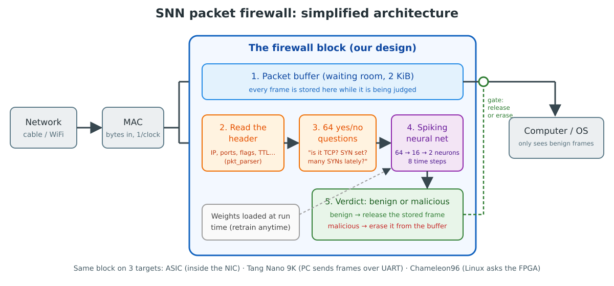

# The SNN packet firewall, explained simply

For readers who are new to the project. No hardware or neural-network background needed.
The full technical versions are `design.md` (the design) and `simulation_explained.md` (the simulation).

---

## 1. The problem

Every message that reaches a computer over a network arrives as **packets** (on Ethernet: *frames*). Some are
attacks:
- floods that try to overload the machine;
- scans that look for open doors;
- malformed packets that try to crash software.

Normally the computer's own software (firewall, antivirus) inspects them, but **only after they have already
arrived inside the operating system**.

**Our idea:** put a small, fast "security guard" in hardware, **inside the network card itself**. It looks at
every frame as it arrives and throws away the bad ones, so the operating system never even sees them.

The guard's "brain" is a **spiking neural network (SNN)**, a kind of neural network that works like real neurons:
they collect electrical charge and "fire" a spike when they are charged enough.

## 2. The architecture in one picture

**An analogy: airport security.**

| our block | airport |
|---|---|
| 1. Packet buffer | the waiting area: every passenger (frame) waits here until cleared |
| 2. Read the header | look at the passport and the boarding pass (addresses, ports, flags) |
| 3. 64 yes/no questions | a checklist: "flying alone? one-way ticket? 20 people with the same ticket in the last minute?" |
| 4. Spiking neural network | the experienced officer who weighs all the answers |
| 5. Verdict | "go through" (frame released to the computer) or "denied" (frame erased) |
| Weights | the officer's training. It can be updated at any time without building new hardware |

Important properties:
- **It never says "wait" to the network.** Frames arrive at full speed (one byte per clock tick). If the waiting area
  overflows, whole frames are dropped and counted, never half frames.
- **Order is kept.** Frames leave in the same order they came in.
- **Decision time is short:** about 28 clock ticks per frame, much less than a frame takes to arrive. So the
  guard keeps up with full 1 Gb/s Ethernet.

## 3. The "brain": how the spiking neural network decides

1. **64 yes/no answers become 64 input spikes.** For example: "is it TCP?", "is the SYN flag set?", "is the
   destination port 0?", "have ≥ 8 of the last 32 frames been SYNs?". A typical frame has about 13 "yes" answers.
2. **16 hidden neurons.** Each "yes" pushes charge (a positive or negative weight) into each hidden neuron. In
   each of 8 time steps, every neuron:
   - leaks a quarter of its charge;
   - adds the new charge;
   - if it reaches the threshold, **fires a spike** and resets to zero.
3. **2 output neurons**, "benign" and "malicious", collect spikes from the hidden neurons the same way.
4. **Decision:** whichever output neuron fired more often in the 8 steps wins (tie: the one with more charge left).

Why spikes? Neurons only do work when something happens, the inputs are mostly "no" (79 % zeros), and the maths
is only additions (no multiplications). That keeps the hardware small and simple.

The 64 questions are fixed rules; the network weights were learned in Python (`model/`) from 60,000 labelled
example frames (synthetic), and checked on another 20,000. The hardware does exactly the same integer arithmetic as the Python model.

## 4. What is a testbench?

We can't plug a design into the internet before it exists. So we **simulate** it, and the **testbench**
(`sim/asic/tb_snn_asic.sv`) is a program that surrounds the design and plays three roles at once:

| role | what it does in the simulation |
|---|---|
| **the network (MAC)** | sends frames into the design byte by byte, with realistic gaps between frames |
| **the computer** | receives what comes out; sometimes it is "busy" and accepts nothing for a while |
| **the CPU / driver** | loads the trained weights, switches modes, reads the counters |

It also **checks everything automatically**:
- every verdict;
- every byte that comes out;
- every counter.

It compares them against the answers the Python model computed in advance. Any difference prints `[ERR]`, and the
end prints `RESULT: PASS` or `FAIL`.

## 5. The test vectors: what we feed in

"Test vectors" are just the input data and the expected answers, stored as text files in `sim/vectors/`:

| file | plain meaning |
|---|---|
| `frames.txt` | **600 network frames**, one per line, as hex bytes, like a recording of real traffic |
| `cfg.txt` | **the trained brain**: 276 numbers (thresholds and weights) to load into the design |
| `expected.txt` | **the answer sheet**: for each frame, the 64 yes/no answers, how often each output neuron fired, the verdict, and the true label |

### The story told by the 600 frames

The frames form one continuous recording, in time order:

| frames | what's happening |
|---|---|
| 0–46 | **a normal day**: web connections, DNS look-ups, pings |
| 47–247 | **a SYN flood attack**: thousands of fake "let's connect" requests to one server, mixed with normal traffic |
| 260–276 | **port-0 probes**: packets to port 0, which no real service uses |
| 341–589 | **an ACK scan**: an attacker sends "acknowledge" packets to many ports to map the firewall, mixed with lots of normal traffic |
| the rest | normal traffic |

### What each kind of frame means

**Normal traffic (402 frames):**

| frames | kind | meaning |
|---|---|---|
| 193 | TCP ACK | "got it": acknowledgements inside normal connections |
| 90 | TCP data (PSH) | actual web/application data |
| 30 | TCP FIN | politely closing a connection |
| 23 | TCP SYN | opening a new connection (normal when there are few of them) |
| 23 | other TCP | other normal TCP packets |
| 12 + 3 | UDP | DNS name look-ups (12) and other UDP (3) |
| 21 | ping / ping reply | "are you there?" and "yes" |
| 2 / 2 / 2 / 1 | ARP / IPv6 / UDP fragments / ICMP unreachable | address look-up, the newer Internet protocol, a large message split in parts, an error report |

**Attacks (198 frames):**

| frames | kind | meaning | how the network recognises it |
|---|---|---|---|
| 153 | **SYN flood** | a flood of connection requests, so the server runs out of memory waiting for them | one SYN looks normal; *many SYNs in the last 32 frames* turns on the "SYN rate" questions |
| 41 | **ACK scan** | ACK packets that don't belong to any connection, used to learn which ports a firewall filters | unusual flag and port and window combinations |
| 4 | **port 0** | traffic to port 0, which is invalid: probing or fingerprinting | the "destination port = 0" question |

The design flags 197 of the 198 attacks and none of the 402 normal frames. The one miss, frame 128, is a SYN
from the flood that the network judged benign (4 "benign" spikes vs 2 "malicious"). The Python model makes the same
call, which proves the hardware copies the model exactly.

> These results come from **synthetic** traffic (generated, not captured), so real-world accuracy will be lower.
> Retraining on real captures (UNSW-NB15 / CIC-IDS2017) is the next step. The tests stay the same.

## 6. The 10 test situations, in plain words

| test | situation | what we want to see | real-life meaning |
|---|---|---|---|
| T1 | switch on (reset) | everything starts empty and in "protect" mode | a freshly booted card is safe, not wide open |
| T2 | load the brain | weights written and read back correctly | the driver can install and check a model |
| T3 | **normal operation**: all 600 frames | every verdict identical to the Python model; only good frames come out, byte-perfect | the core proof that the hardware works |
| T4 | **monitor mode** | judges and counts, but lets everything through | try it on a real network first and count false alarms without blocking anyone |
| T5 | **bypass** | lets everything through | the emergency "off switch" |
| T6 | **corrupted frames** (damaged on the cable) | thrown away completely, counted, never judged | broken frames never reach the computer |
| T7 | **huge, tiny and maximum-size frames** | too-big frames dropped whole; tiny and maximum-size frames pass intact | odd sizes can't confuse or crash the design |
| T8 | **full speed** | no frame lost at 1 Gb/s with the smallest frames | it keeps up with a real network |
| T9 | **overload** (computer too slow, traffic too fast) | some whole frames dropped, none corrupted, none reordered, counters add up | it degrades gracefully under attack or congestion |
| T10 | **reset in the middle of traffic** | clean restart, then perfect operation again | a reset or crash recovery leaves nothing half-done |

All 10 passed in the university's Cadence simulator (xrun) and in our Questa simulator. They also passed on the
"gate-level" version of the design (the real logic gates after synthesis).

## 7. Reading the waveform

A waveform shows every signal (horizontal rows) over time (left to right). Green blocks are data; thin lines are
single on/off signals.

| row | what to look for |
|---|---|
| `s_axis_tdata` / `tvalid` / `tlast` | frames going **in**: dense green = lots of traffic; `tlast` ticks once per frame |
| `m_axis_tdata` / `tvalid` / `tlast` | frames coming **out** to the computer. Fewer than going in, because attacks were removed |
| `m_axis_tready` | the computer saying "I'm ready". Flickering = sometimes busy; flat = always ready |
| `verdict_valid` | one tick per judged frame |
| `verdict_mal` | ticks when that frame was judged malicious. Look for bursts during the SYN flood |
| `s_axis_tuser` | "this frame is damaged": only appears in T6 |
| `cfg_addr` / `cfg_wdata` | the CPU loading weights or changing modes: the boundaries between tests |
| `s_axis_tready` | always high: the design never blocks the network |

Rough timeline (total 3.2 ms of simulated time):
- 0–1.03 ms: T1–T3.
- 1.03 / 1.27 ms: switch to monitor mode / bypass (T4, T5).
- 1.51–1.69 ms: the corrupted frames (T6).
- then size limits (T7) and full speed (T8).
- 2.09–3.1 ms: overload (T9).
- the end: reset recovery (T10).

## 8. Where it runs

| target | how the frames get there | status |
|---|---|---|
| **ASIC** (a custom chip) | straight from the network cable, inside the network card | simulated; synthesized with Cadence (90 nm) and laid out in open-source sky130 |
| **Tang Nano 9K** FPGA | a PC sends recorded frames over a USB-serial cable; the FPGA sends back only the good ones; 8 LEDs show what's happening | simulated; bitstream to rebuild for the perfboard pins |
| **Chameleon96** FPGA + Linux | the Linux WiFi driver hands each frame to the FPGA, which answers "keep" or "drop" | board test passed: all 600 frames give identical answers on the real FPGA; live WiFi test next |

## 9. Mini glossary

| term | meaning |
|---|---|
| frame / packet | one network message; the header is its "envelope" (addresses, ports, flags) |
| SYN / ACK / FIN / PSH | TCP flags: start a connection / acknowledge / finish / push data |
| port | a number that says which service a message is for (80 web, 53 DNS, 22 SSH …) |
| MAC | the part of a network card that turns cable signals into bytes |
| FPGA | a chip whose logic can be re-programmed: used to try the design for real |
| ASIC | a custom-made chip: the final goal |
| RTL | the design written as code (Verilog) |
| gate-level / netlist | the design after conversion into real logic gates |
| testbench | the simulated environment that drives and checks the design |
| golden model | the Python reference that defines the correct answers |
| bit-exact | the hardware's answers are identical to the reference, bit for bit |
| weights | the learned numbers inside the neural network |
| spike | a neuron "firing": a 1 at one time step |
