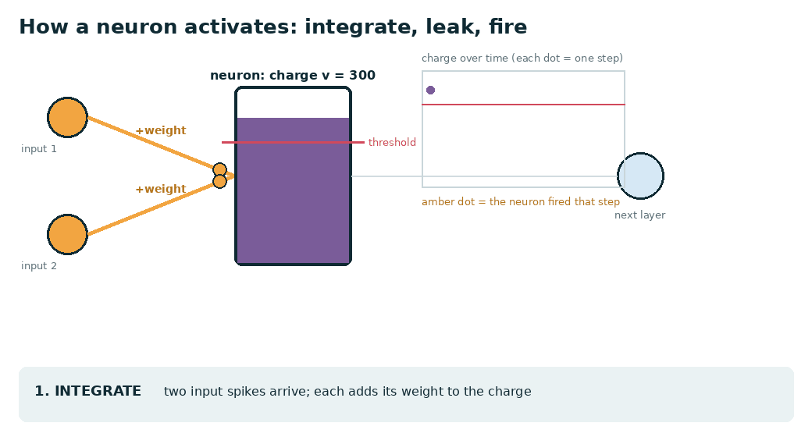
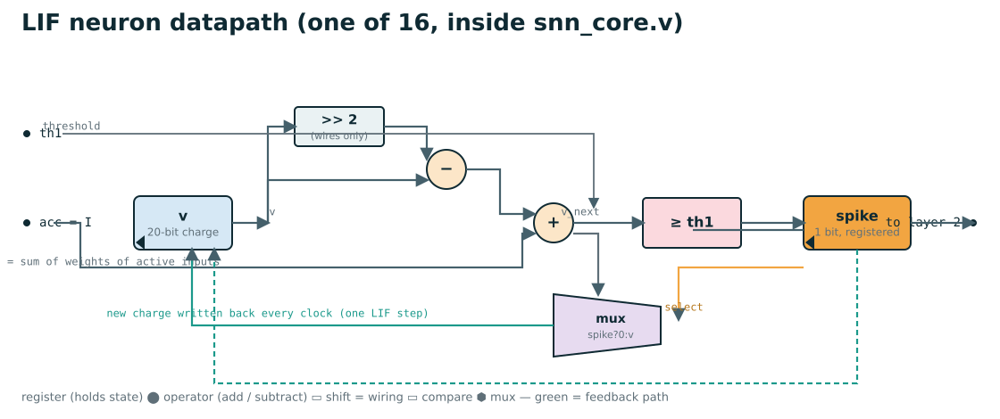
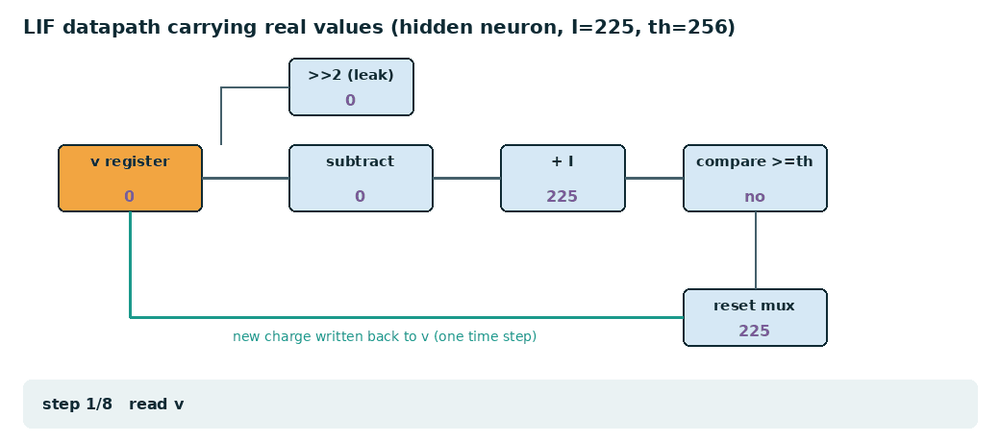
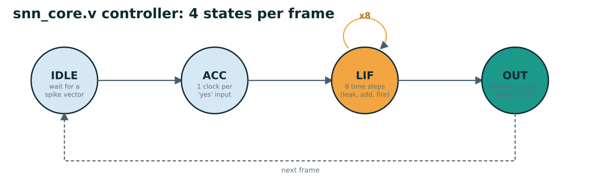
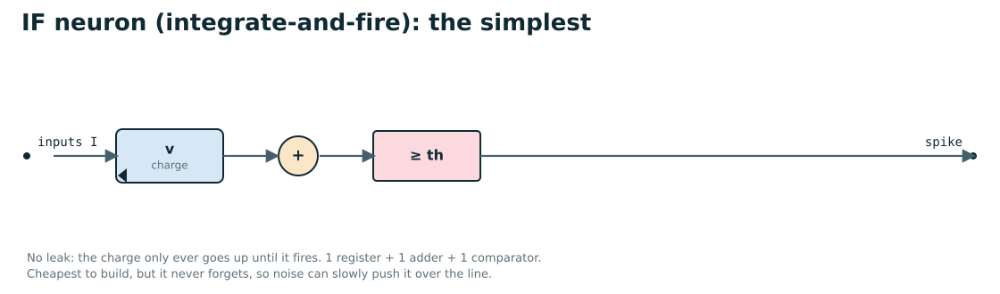
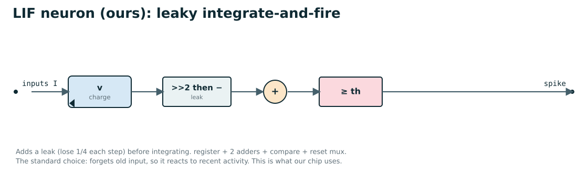
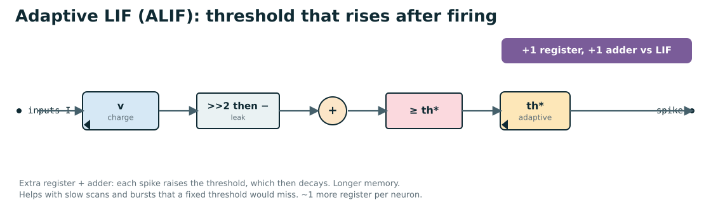
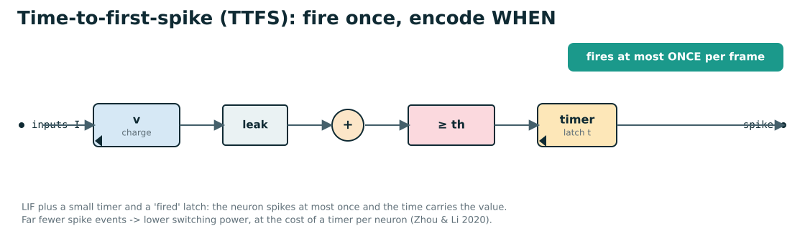
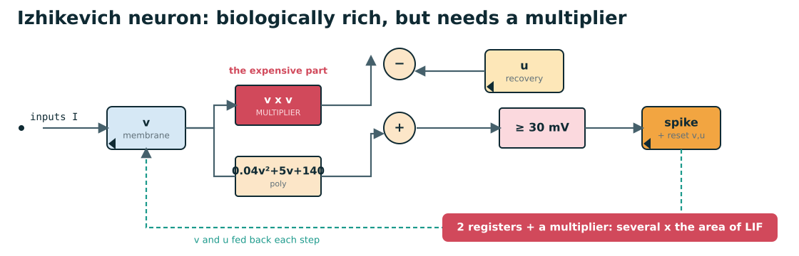
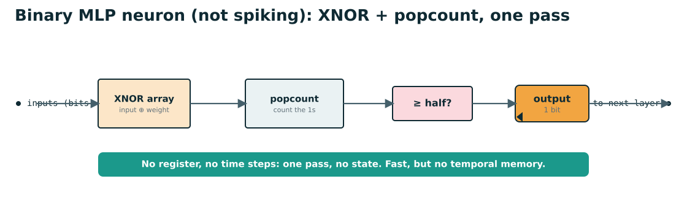

# The neuron in hardware (HDL), explained with diagrams

This explains the actual Verilog of one neuron (`rtl/snn_core.v`), with animations and RTL-Viewer-style
datapath diagrams. At the end are the same diagrams for **other** neuron models (IF, adaptive LIF,
time-to-first-spike, Izhikevich, and a non-spiking binary neuron) so you can compare the hardware cost.

New to the idea of a neuron? Start with `docs/explained_simply.md` and `docs/demo_explained.md`.

## 1. How a neuron activates (the one thing to get right)



A common misconception is that a neuron "leaks its charge to the next neuron". It doesn't. Here is what really
happens, step by step (the animation shows it):

1. **Integrate.** Input spikes arrive from the previous layer. Each one adds its *weight* to this neuron's charge
   (a number called the membrane potential, `v`).
2. **Leak.** Every time step the neuron loses a fraction of its **own** charge, a quarter in our design. This is
   internal decay, a leaky bucket draining; it is **not** sent anywhere. It just makes the neuron forget old input.
3. **Fire.** When the charge crosses the threshold, the neuron emits a single **1-bit spike** and resets its charge
   to 0. **That fired spike is the only thing that travels to the next layer** — not the charge, not the leak.

So the data moving between layers is always a 1 or a 0 (a spike or no spike), never the analogue charge. The charge
lives inside the neuron. This is why the hardware is cheap: a weight times a spike is just "add the weight, or don't".

This model is called **LIF** = **L**eaky **I**ntegrate-and-**F**ire.

## 2. The HDL: one LIF neuron as a datapath

In `rtl/snn_core.v` the update for one neuron is three lines of Verilog:

```verilog
v_next = v - (v >>> leak) + I;      // 1. leak (v >>> 2 = v/4), then 2. integrate (+ I)
spike  = (v_next >= th1);           // 3. fire if over the threshold
v      = spike ? 0 : v_next;        // reset to 0 on a spike, else keep the new charge
```

As hardware that is a register, a shift, two adders, a comparator and a reset multiplexer:



| block | what it is | Verilog | cost |
|---|---|---|---|
| **v register** | holds the 20-bit charge between time steps | `reg signed [19:0] v1[h]` | 1 register |
| **>> 2** | divide the charge by 4 (the leak). A shift is **just wiring**, no gates | `v >>> leak` | free |
| **subtract** | `v − v/4`, i.e. keep 3/4 of the charge | `v - (v>>>leak)` | 1 subtractor |
| **+ I** | add the input current (the sum of the weights of this frame's active inputs, computed once) | `+ I` | 1 adder |
| **≥ th1** | compare with the threshold | `>= th1` | 1 comparator |
| **mux** | write 0 back on a spike, otherwise the new charge | `spike ? 0 : v_next` | 1 multiplexer |

The **green feedback path** is the key: the new charge is written back into the same register every clock, so one
clock = one time step. There are **16 of these in parallel** (one per hidden neuron) plus 2 for the output layer,
and **no multiplier anywhere** — that is the whole point of using spikes.

This is the datapath carrying real numbers, step by step (input current I = 225, threshold 256):



## 3. How the datapath is driven: the 4-state controller

One neuron fires over 8 time steps, but the whole core also has to load the input, run those steps, and report. A
small state machine in `snn_core.v` does that:



- **IDLE** — wait for a new 64-bit spike vector.
- **ACC** — compute the input current I once, visiting only the inputs that are 1 (one weight row per clock). This is
  the "event-driven" trick: an all-zero input costs almost nothing.
- **LIF** — run the datapath above for 8 time steps; all 16 hidden neurons update in parallel, and the 2 output
  neurons follow two cycles behind through a pipelined adder tree.
- **OUT** — compare the two output neurons' spike counts and report the verdict.

Latency per frame ≈ (number of active inputs) + 8 + 6 cycles ≈ 28 clocks. Details in `docs/design.md` §2.5.

## 4. Where to see this in Quartus (RTL Viewer)

The real, tool-drawn version of these schematics is in Quartus:

1. Open the project **`fpga/cv96_snn/led_blink_linux.qpf`** in Quartus (File → Open Project).
2. Process → Start → **Start Analysis & Elaboration** (needed before the viewer has a netlist). This writes
   `db/led_blink_linux.rtlv.hdb`; command-line equivalent: `quartus_map --analysis_and_elaboration led_blink_linux`
   (it prints "Analysis & Elaboration was successful" but exits non-zero when there are only connectivity warnings,
   which is harmless here).
3. Tools → Netlist Viewers → **RTL Viewer**.
4. In the hierarchy on the left, drill into `snn_0` → the classifier → `snn_core`. Double-click a block to go
   inside; the `v1`/`acc` registers, the adders and the comparator appear just like the diagram above.

The build **reports** (fit, timing, resource usage) are in `fpga/cv96_snn/output_files/*.rpt` and `*.summary` —
these are git-ignored build outputs, so they exist on the machine that ran `fpga/cv96_snn/build.sh`. The smaller
`fpga/fit_check/snn_fw_fit.qpf` project fits the in-line filter on its own.

---

## 5. Other neuron models, as HDL diagrams

Our LIF neuron is one point on a spectrum. These are the main alternatives, drawn the same way so the extra hardware
is visible. The trade-offs are summarised in the slide deck and `docs/ppa_and_novelty.md` §5.

### IF — integrate-and-fire (the simplest)


No leak at all: the charge only climbs until it fires. The cheapest neuron (one register, one adder, one
comparator), but because it never forgets, slow drip of input eventually fires it, so it is noisier.

### LIF — our neuron


Adds the leak (lose 1/4 each step) before integrating. The standard choice: it reacts to *recent* activity and
forgets old input. This is what the chip uses.

### ALIF — adaptive LIF


Each spike raises the neuron's own threshold, which then decays back down, so a neuron that just fired is harder to
fire again. This gives a longer memory (good for slow scans and bursts) at the cost of **one extra register and
adder per neuron**.

### TTFS — time-to-first-spike


The neuron fires **at most once**, and the information is in *when* it fires (an early spike = strong input). A small
timer latches the firing moment. Far fewer spike events means lower switching power, at the cost of a timer per
neuron (Zhou & Li 2020).

### Izhikevich — biologically rich, but expensive


Two coupled state variables (`v` membrane, `u` recovery) and a **quadratic** term (`v²`) reproduce many real
neuron behaviours. The `v²` needs a **multiplier**, and there are two registers, so one Izhikevich neuron is several
times the area of a LIF neuron. Overkill for a packet classifier, but common in neuroscience accelerators.

### Binary MLP neuron — not spiking, for comparison


Not an SNN at all: binarised weights, so each input-times-weight is an XNOR, the results are counted (popcount), and
the neuron fires if the count passes half. **No register, no time steps** — one pass, no state. Fast and small, but
it has no notion of time, so it can't use the "many SYNs lately" kind of temporal feature the way our SNN does. This
is the style used by in-NIC binary-neural-network work such as N3IC.

### At a glance

| model | state per neuron | multiplier? | time steps | best for |
|---|---|---|---|---|
| IF | 1 register | no | several | cheapest, noisy |
| **LIF (ours)** | **1 register** | **no** | **8** | **recent-activity detection; our chip** |
| ALIF | 2 registers | no | several | slow scans, bursts |
| TTFS | 1 reg + timer | no | until it fires | low-power, sparse events |
| Izhikevich | 2 registers | **yes** | many | rich dynamics (neuroscience) |
| Binary MLP | none | no (XNOR) | 1 (one pass) | fast, no temporal memory |

*Regenerate every diagram and GIF here:* `python3 docs/slides/make_neuron_diagrams.py` (SVGs need nothing; GIFs need Pillow).
