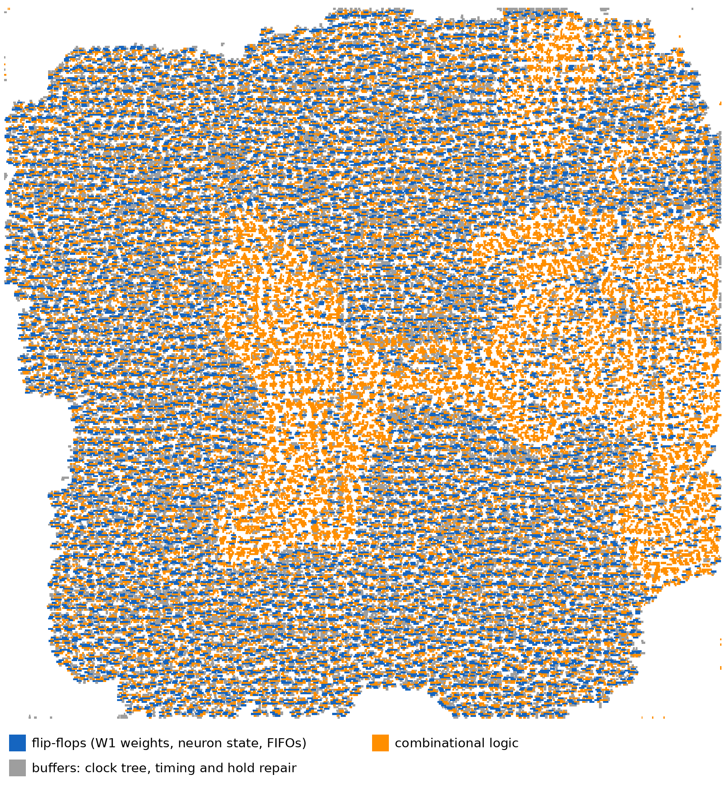
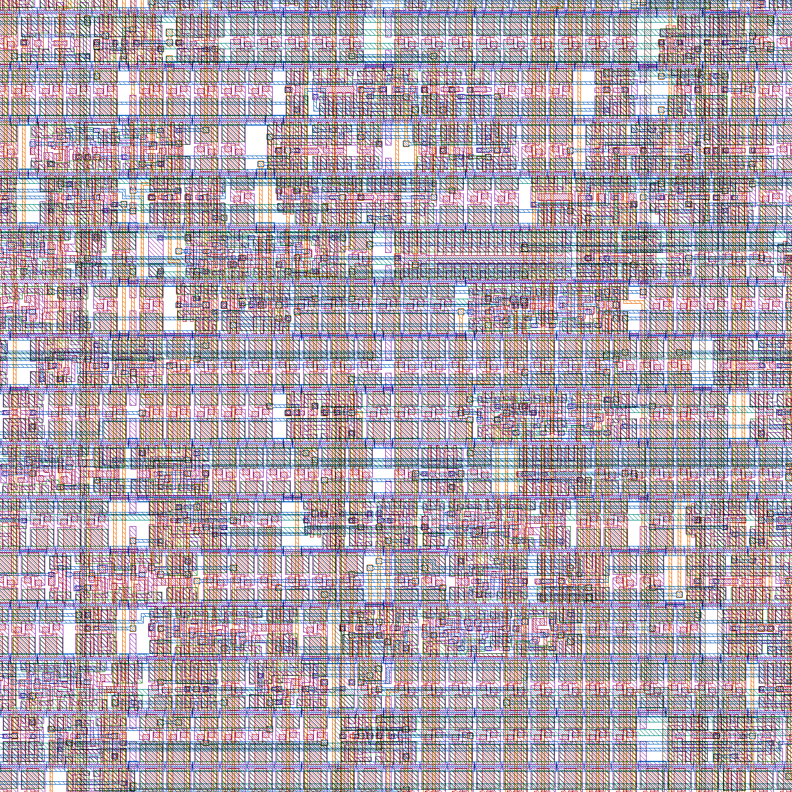

# Area, power, timing, novelty, and SNN vs other approaches

All numbers below come from tools that actually ran on this design. Where something has not been measured yet, the
table says so instead of guessing.

**Sources:**
- sky130 = SkyWater 130 nm, `sky130_fd_sc_hd` cells.
  - Full-chip synthesis: Yosys + ABC on this laptop.
  - `snn_classifier` place & route: LibreLane / OpenROAD in GitHub Actions run 38404219489 (commit `d2753b2`); the
    results are on the `gds-snn_classifier` release.
- Cyclone V = Quartus 20.1 fitter and timing reports.
- Tang Nano 9K = Yosys + nextpnr-himbaechel.
- Cadence 90 nm (gsclib090) = Genus on the uni server. The run completed; its numbers go in §1 once `qor.rpt` is
  in.

---

## 1. Headline numbers

| target | block | area / resources | clock | power |
|---|---|---|---|---|
| **sky130, placed & routed** | `snn_classifier` (parser + encoder + SNN + config) | die 1.125 × 1.136 mm = **1.28 mm²**; std cells 0.707 mm², 72,032 cells; 0 DRC, 0 LVS | 10 ns target: **≈ 99 MHz typical**, ≈ 136 MHz fast corner, ≈ 51 MHz slow corner | **125 mW** @ 100 MHz, typical corner (vectorless estimate) |
| sky130, synthesis | `snn_pkt_filter_asic` (full chip incl. 2 KiB buffer) | **1.16 mm²** cell area, 71,120 cells | n/a (no timing analysis) | n/a |
| Cyclone V (Chameleon96) | look-aside accelerator + HPS system | 2,378 ALMs (6 %), 3,080 registers, 9,776 BRAM bits, 0 DSP | **110.8 MHz** Fmax, 100 MHz used (+0.975 ns slack) | not measured (run `quartus_pow`) |
| Cyclone V (stand-alone fit) | in-line filter over Avalon (4 KiB buffer) | 5,871 ALMs (14 %), 10,336 registers, 64,020 BRAM bits, 0 DSP | 111.6 MHz | not measured |
| Tang Nano 9K (GW1NR-9) | in-line filter + UART/SLIP | 6,966 LUT4 (80 %), 2,627 DFF (41 %), 6 BSRAM, 33 RAM16, 0 DSP (last completed build; the perfboard version with 8 LEDs places at 7,035 LUT4 / 2,657 DFF) | 57.6 MHz routed, 27 MHz used | not measured |
| Cadence 90 nm | `snn_pkt_filter_asic`, 8 ns target | *Genus finished; area/slack/power to be added from `reports/qor.rpt`* | | |

**No multipliers anywhere:** 0 DSP blocks on both FPGAs. The SNN datapath is additions, shifts and compares only.

---

## 2. Area: where it goes

### 2.1 Full chip (`snn_pkt_filter_asic`, sky130 synthesis, 1.159 mm²)

| block | what it is | area (µm²) | share of chip | sequential share inside the block |
|---|---|---|---|---|
| `snn_pkt_filter` | **2 KiB packet buffer** (2048 × 9-bit flip-flops) + ingress/egress control + counters | 710,965 | **61.3 %** | 78.7 % |
| `snn_core` | **W1 weight memory** (64 × 128-bit flip-flops) + neurons + adder tree | 392,857 | **33.9 %** | 68.1 % |
| `snn_classifier` (glue) | config registers, W2, thresholds | 14,217 | 1.2 % | 53.5 % |
| FIFOs (feature + verdict) | queues between the stages | 24,491 | 2.1 % | ≈ 81 % |
| `pkt_parser` | header field extraction | 9,496 | 0.8 % | 50.5 % |
| `spike_encoder` | 64 features + rate window | 7,030 | 0.6 % | 39.8 % |

**Sequential vs combinational, whole chip:**

| | cells | area |
|---|---|---|
| sequential (flip-flops) | 29,313 (41 %) | 862,400 µm² (**74 %**) |
| combinational | 41,807 (59 %) | 296,960 µm² (**26 %**) |

**What the flip-flops are:**

| | flip-flops | share of all flip-flops |
|---|---|---|
| packet buffer | 18,432 | 62.9 % |
| W1 weights | 8,192 | 27.9 % |
| **memory total** | **26,624** | **90.8 %** |
| SNN neuron state (membranes, input current, spike counts, pipeline) | ≈ 990 | 3.4 % |
| everything else (parser, encoder, FIFOs, counters, config) | ≈ 1,700 | 5.8 % |

**The design is "sequential-heavy" because both memories are built from flip-flops, not because it is an SNN.**
With SRAM macros (the plan before tape-out), the two memories shrink by about 2× (open-source OpenRAM on sky130)
up to 5× or more (a foundry SRAM compiler), and the logic becomes mostly combinational.

### 2.2 `snn_classifier` after place & route (sky130, OpenROAD)

*Every placed cell, coloured by type. The flip-flop memory (blue) and its buffers (grey) spread over the outside;
the SNN arithmetic (orange: input accumulation, leaky-integrate-and-fire update, output adder tree) forms the dense
core in the middle.*

| cell class | cells | area (µm²) | share of std-cell area |
|---|---|---|---|
| sequential (flip-flops) | 10,256 | 218,154 | 30.9 % |
| combinational logic | 25,447 | 281,466 | 39.8 % |
| timing-repair buffers (incl. 9,494 hold buffers) | 16,704 | 159,768 | 22.6 % |
| clock tree | 1,748 | 24,674 | 3.5 % |
| tap / antenna cells | 17,877 | 22,623 | 3.2 % |
| **total std cells** | **72,032** | **706,685** | 100 % (57 % utilisation of the 1.24 mm² core) |

Logic only (before timing repair): **43.8 % sequential / 56.2 % combinational** (Yosys report inside the CI run).

This is lower than the full chip's 74 % for two reasons:
- this block has no packet buffer;
- LibreLane builds each enable flip-flop as a plain flip-flop plus a multiplexer, and the multiplexer counts as
  combinational. The Yosys full-chip run used sky130's enable flip-flop cell instead.

*A 40 × 40 µm patch from the middle of the die: rows of standard cells. Shown: diffusion (green), polysilicon
(red), local interconnect (purple), metal 1–3 (blue, orange, teal).*

### 2.3 Why there are 9,494 hold buffers

10,256 flip-flops on one clock make a large clock tree, with up to 1.0 ns skew at the slow corner. OpenROAD fixes
the resulting hold-time risks by adding small delay cells: 9,494 of them, 22.6 % of the area. SRAM for W1 would
remove most of these flip-flops, and with them most of the buffers.

---

## 3. Timing

| target | constraint | result | meaning |
|---|---|---|---|
| sky130 `snn_classifier`, typical corner (25 °C, 1.8 V) | 10 ns | setup WNS −0.077 ns (10 endpoints) | ≈ 99 MHz: just misses 100 MHz |
| sky130, fast corner (−40 °C, 1.95 V) | 10 ns | +2.63 ns | ≈ 136 MHz |
| sky130, slow corner (100 °C, 1.6 V) | 10 ns | −8.7 ns nominal / −9.6 ns worst; hold −0.69 ns (91 endpoints) | ≈ 51 MHz; needs pipelining or a lower clock |
| Cyclone V, SNN clock | 10 ns | +0.975 ns, Fmax 110.8 MHz (slow 1100 mV 100 °C model) | meets 100 MHz |
| Tang Nano 9K | 37 ns (27 MHz) | Fmax 57.6 MHz | 2.1× margin |
| Cadence 90 nm | 8 ns (125 MHz) | *to be added* | |

The CI run is marked "failed" only because of these sky130 timing violations. Everything else is clean:
- DRC: 0 (Magic, KLayout and the router);
- LVS: 0;
- antenna: 0;
- power grid: 0 violations.

The likely fix is a 12 ns clock for sky130 (≈ 83 MHz, still above the 1.49 M frames/s that 1 GbE needs), or one more
pipeline stage in the neuron update.

**Throughput, which matters more than raw clock speed:**
- Classification takes **(active inputs) + T + 6 cycles**. The test traffic averages 13.5 active inputs of 64, so
  that is **≈ 28 cycles per frame**.
- The smallest Ethernet frame occupies 84 byte-times on the wire. At one byte per clock, the classifier has 3× the
  time it needs, so **1 GbE line rate is sustained**. Test T8 confirms it: 250 back-to-back minimum-gap frames,
  0 drops.
- Look-aside on the Chameleon96: ≈ 1.6 µs per frame including the bus transfer (simulation), i.e. ≈ 0.63 M frames/s.

---

## 4. Power

**sky130 `snn_classifier`, 100 MHz, typical corner, vectorless (OpenROAD/OpenSTA default switching activity):**

| component | power | share |
|---|---|---|
| internal (inside cells, mostly the flip-flops and clock buffers toggling with the clock) | 82.9 mW | 66 % |
| switching (charging wires) | 42.5 mW | 34 % |
| leakage | 1.3 µW | ≈ 0 % |
| **total** | **125.4 mW** | |

**How to read it:**
- It is an **upper-end estimate**. Vectorless analysis assumes generic toggle rates; a simulation-based (VCD/SAIF)
  analysis would be lower.
- **Most of it is clocking flip-flops that never change.** The 8,192 W1 flip-flops hold constant weights after
  loading, yet they are clocked 100 million times a second. Clock-gating W1 (or storing it in SRAM) should remove a
  large part of the internal power. That is the single biggest improvement available. *Estimate, to be measured.*
- **Energy per decision:** 125 mW × 28 cycles × 10 ns ≈ **35 nJ per frame** while classifying. At full 1 GbE load
  (1.49 M frames/s), with the clock always running, that's ≈ 84 nJ per frame.
- **Not measured yet:** FPGA power (`quartus_pow` on the Chameleon96 project; Gowin has no open power tool) and the
  Cadence 90 nm power (`reports/power.rpt` from Genus is already on the server).

---

## 5. Is an SNN a good choice here? Comparison with other approaches

### 5.1 Work per frame for this exact network size (64 inputs → 16 → 2)

| model | operations per frame | multipliers | weights | latency | notes |
|---|---|---|---|---|---|
| **our SNN** (event-driven, T = 8) | ≈ 216 adds (13.5 active rows × 16 neurons) + 8 steps × ≈ 84 add/shift/compare ≈ **900 simple ops** | **0** | 1.1 KB int8 | ≈ 28 cycles | only active inputs are visited; spikes are 1-bit, so layer 2 is adds only |
| equivalent int8 MLP (ReLU) | 1,024 MAC (layer 1) + 32 MAC (layer 2) ≈ **1,056 MAC**. With binary inputs, layer 1 also becomes ≈ 216 conditional adds if written sparse-aware | 32 (8 × 8-bit, layer 2) | 1.1 KB | 1 pass, ≈ 5–20 cycles pipelined | single pass and no state, so lower latency |
| small 1D-CNN on 128 header bytes (e.g. 3 conv layers, 32 filters, kernel 3, then dense) | ≈ 10⁵–10⁶ MAC (illustrative) | many (DSP-bound) | 10–100 KB | 100s–1000s of cycles, unless massively parallel | learns its own features from raw bytes, but 100–1000× the compute |
| decision tree / random forest (as in in-switch ML) | ≈ depth compares (10–20) | 0 | small tables | a few cycles | very cheap and easy to put in pipelines; no stateful time dynamics; accuracy depends on features |
| rule-based ACL / signature match | table lookups | 0 | TCAM / hash tables | 1–few cycles | exact and fast, but only catches what is written in the rules |

### 5.2 Advantages and disadvantages of the SNN

**Advantages:**
- **No multipliers.** Binary spikes turn every weight multiplication into "add the weight or not": no DSP blocks
  (confirmed: 0 DSP on both FPGAs) and smaller ASIC arithmetic.
- **Work scales with activity (event-driven).** With 79 % zero inputs, only ≈ 13 of 64 weight rows are read per
  frame. An idle network costs only clock power, which clock gating can remove.
- **Natural time / state handling.** Membranes integrate over time steps, and the same machinery extends to
  temporal patterns (flows, bursts). Combined with the hardware rate window, floods are detected per packet without
  flow tables.
- **Neuromorphic path.** On-chip learning (STDP, from the `snn_stdp` base design) could later adapt weights in the
  field, which an MLP or CNN can't do as cheaply.

**Disadvantages:**
- **Latency of T time steps.** 8 iterations instead of 1 pass. Fine here (28 cycles ≪ 84), but a single-pass MLP
  would be faster.
- **Extra state.** Each neuron needs a 20-bit membrane plus spike counters: ≈ 990 flip-flops for this network
  (≈ 3 % of the chip's flip-flops). A combinational MLP needs none. So yes, an SNN has more *sequential*
  (state-holding) logic than an equivalent MLP or a streaming CNN of the same size. But in this design that state
  is small next to the weight and packet memories, which any approach needs (a CNN needs far more weight memory).
- **Harder training.** Spikes aren't differentiable, so training uses surrogate gradients (Neftci et al., in
  `Papers/`) and quantisation-aware integer simulation. It is more involved than training an MLP or a tree.
- **The energy advantage is not automatic.** Plagwitz et al., "To Spike or Not to Spike?" (`Papers/2306.12742`),
  found that on FPGAs SNNs can be faster in some cases but can fall short of CNNs in average power on small tasks.
  The benefit depends on sparsity and on avoiding idle clocking. For us that means clock gating and SRAM are needed
  to realise the power advantage.
- **Accuracy is unproven on real traffic.** Results so far are on synthetic data (99.7 % on 20,000 synthetic test
  frames; 197/198 attacks and 0 false alarms in the 600 hardware vectors). Prior SNN intrusion-detection work
  reports, for example, 90.12 % on the IBM TrueNorth chip (Alom & Taha, `Papers/`). Real UNSW-NB15 / CIC-IDS2017
  results are needed before claiming accuracy.

---

## 6. Novelty: what is different from existing work

**What exists** (papers in `Papers/`):

| work | what it does | difference from ours |
|---|---|---|
| Alom & Taha, *Network intrusion detection … on neuromorphic computing system* (IBM TrueNorth) | SNN IDS on a neuromorphic chip, 90.12 % accuracy | the chip sits **off the data path**: software encodes the data and sends it over |
| Zhou et al., *SNNs with single-spike temporal-coded neurons for NID* (ICPR 2020); *Event-driven IDS using SNNs for edge/IoT* (ICSCSA 2025); Rasteh et al., *encrypted traffic classification with SNN* | SNN classifiers for traffic, in software or a simulator | algorithms; no line-rate hardware datapath |
| Taurus (Swamy et al.) | per-packet ML inside a **switch** data-plane pipeline | switch ASIC, non-spiking models (DNN / SVM / k-means); not at the NIC → host boundary |
| generic FPGA SNN accelerators (several in `Papers/`) | SNN inference engines, mostly image benchmarks | not network-specific; not fused with a MAC |
| nPrint (Holland et al.) | standard bit-level packet representation for ML | software representation; our 64 header spikes are a hardware-friendly cousin |

**What this design adds.** To the best of our knowledge, based on the papers above, this needs confirming with a
wider search; see below.

1. **The SNN classifier is fused into the NIC receive datapath.** It sits between the MAC's FCS check and the
   host-side FIFO/DMA (`rtl/eth_mac_1g_snn_fifo.v`). The network controller and the classifier, normally two
   separate paths (NIC → OS → IDS software), become **one hardware path**, and a malicious frame is erased before
   DMA, so the OS never touches it. Supporting this needed:
   - a store-and-forward buffer with **commit/rollback**;
   - **in-order verdicts**;
   - a design that **never back-pressures** the MAC;
   - whole-frame dropping under overload.

   All of these are verified (T1–T10, including GMII-level and gate-level runs).
2. **Event-driven SNN with single-pass input current.** Header spikes are static per frame, so the hidden-layer
   input is computed once, visiting only the active inputs. Latency is (active inputs) + T + 6 cycles, and there are
   no multipliers.
3. **Stateful hardware rate features feeding the SNN.** A 32-frame sliding window of SYN and ICMP-echo counts
   becomes spikes, so per-packet decisions can catch floods without flow tables.
4. **One engine, three deployments, bit-exact everywhere:**
   - in-line ASIC/NIC;
   - in-line FPGA (Tang Nano 9K);
   - look-aside SoC with a Linux `rx_handler` hook (Chameleon96).

   All match the same Python golden model, and weights load at run time, so retraining needs no new hardware.
5. **Fail-safe behaviour designed in:** monitor mode, bypass, fail-open on timeout (look-aside), and graceful overload.

**Check before claiming novelty in a report.** Search IEEE Xplore / ACM DL for "SmartNIC neural network inference",
"in-NIC intrusion detection", "spiking neural network FPGA packet classification" and "in-network machine
learning". In particular, read these two related works, which are not in `Papers/` yet:
- **N3IC** (Siracusano et al., "Re-architecting Traffic Analysis with Neural Network Interface Cards", USENIX NSDI
  2022): binary neural networks on SmartNICs.
- **IIsy** (Xiong and Zilberman, "Do Switches Dream of Machine Learning?", ACM HotNets 2019): in-switch
  classification.

The likely defensible claim: **the first spiking-neural-network classifier integrated in-line in a NIC/MAC receive
datapath, at line rate, with drop-before-DMA.**

---

## 7. Next improvements, and what each buys

| change | area | power | timing |
|---|---|---|---|
| SRAM macro for the packet buffer (2 KiB) and W1 (1 KiB) | about −40 % (OpenRAM, sky130) to −65 % (foundry SRAM) of the chip | large cut in clock power | removes most hold buffers and clock skew |
| clock-gate W1 and idle stages | small | likely the biggest power cut (to be measured) | — |
| one more pipeline stage in the LIF update / adder tree | +1–2 % | ≈ 0 | sky130 slow corner toward 100 MHz |
| VCD-based power (switching activity from the T1–T10 simulation) | — | realistic numbers instead of vectorless | — |
| real-dataset training (UNSW-NB15, CIC-IDS2017) | — | — | — (needed for accuracy claims) |
