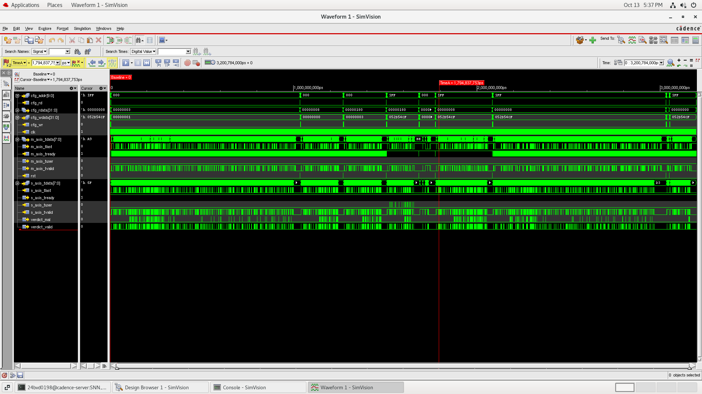

# Verification guide: how to test the design in every workflow

This is the single place that says **how to test and verify** the SNN firewall, from simulation on the laptop to
the two FPGA boards and the Cadence flow at the university.
- Design, signals and register maps: `docs/design.md`.
- What the test vectors contain and how to read a waveform: `docs/simulation_explained.md`.
- The compact ASIC test table: `docs/functional_verification.md`.

## 0. Overview

| # | workflow | verifies | tools | one command | pass criterion |
|---|---|---|---|---|---|
| A | **simulation on the laptop** | RTL of every variant + gate-level netlists, bit-exact vs the golden model | Questa `vsim`, Yosys, iverilog | `sim/run_all.sh` | `12 passed, 0 failed` |
| B | **Cadence on the uni server** | ASIC RTL, synthesis, equivalence, P&R, gate-level with delays | Xcelium `xrun`, Genus, Conformal, Innovus | `asic/scripts/run_flow.sh all` | `RESULT: PASS (10 tests)` on RTL / GLS / SDF; LEC equivalent; timing met; DRC/connectivity clean |
| C | **Tang Nano 9K over UART** | the in-line NIC datapath on real silicon | Yosys + nextpnr + Apicula, openFPGALoader, Python | `python3 sw/tang9k/tang_demo.py --port /dev/ttyUSB0` | `RESULT: PASS` (verdicts and forwarded frames identical to the model) |
| D | **Chameleon96 SoC + FPGA, Linux** | the look-aside accelerator + kernel hook on a live network | Quartus RBF, Yocto kernel module, `snn_fwctl` | `./snn_fwctl selftest frames.txt expected.txt` | `RESULT: PASS`, then live attack counters / LED1 |
| E | **sky130 RTL → GDS** | that the design is physically implementable in an open PDK: timing, DRC, LVS | LibreLane on GitHub Actions | push to `main` (or Actions → Run workflow) | green run; release `gds-<design>` with 0 DRC / 0 LVS errors |

Everything compares against one reference: the Python golden model in `model/`, and the vectors in `sim/vectors/`
written by `.venv/bin/python model/export.py`. If you retrain, re-export, and every workflow re-checks automatically.

---

## 1. Testbenches, stimuli and checks

| testbench | DUT | stimulus | checks | expected result (current vectors) |
|---|---|---|---|---|
| `sim/asic/tb_snn_asic.sv` | `snn_pkt_filter_asic` (ASIC top), ports only | 10 tests T1–T10: reset, config load/readback, 600 golden frames (random gaps 12–40 cycles, 90 % host ready), monitor mode, bypass, bad-FCS frames, 2148 B / 8 B / 1518 B frames, line-rate burst, overload (gaps 1–3, host 35 % ready), reset mid-traffic | verdict sequence, forwarded bytes, all 6 counters, register values; works on RTL and netlists | `RESULT: PASS (10 tests)`; T3 `frames=600 mal=197 forwarded=403 blocked=197` |
| `sim/asic/tb_snn_pkt_filter.sv` | `snn_pkt_filter` (4 KiB buffer) | 600 frames MAC-style, random gaps 12–40, 90 % host ready. Stress mode: gaps 1–3, 35 % ready | **every 64-bit spike vector** (internal), every verdict incl. spike counts, egress bytes; stress: integrity and counter balance | `PASS (bit-exact…)`, `TP=197 FP=0 TN=402 FN=1`; stress `committed=260 dropped_ingress=340`, `PASS (stress/integrity)` |
| `sim/asic/tb_eth_mac_snn.sv` | `eth_mac_1g_snn_fifo` (verilog-ethernet MAC + filter) | the same frames driven **at the GMII pins** with preamble `55…D5` and a computed CRC-32 FCS, gaps 11–30 bytes; host 90 % ready | verdicts, frames delivered to the host side, no bad frames delivered | `RESULT: PASS (MAC + SNN firewall integration)` |
| `sim/tang9k/tb_tang9k.sv` | `tang9k_snn_top` | the PC side: SLIP-encoded `'C'` writes of `cfg.txt`, then 120 `'P'` frames over a UART (4 clocks/bit in simulation), at most 8 in flight | `'V'` verdicts vs the model, `'F'` frames = expected benign frames | `frames=120 verdicts=120 forwarded=64`, `RESULT: PASS` |
| same, gate-level (`sim/tang9k/run.sh gl`) | the Yosys `synth_gowin` netlist that goes into the bitstream | 60 frames | same | `RESULT: PASS` |
| `sw/tang9k/tang_demo.py` + `fake_tang.py` (`sim/tang9k/run.sh host`) | the PC demo program against a software board on a pseudo-terminal | 200 frames | verdicts and forwarded frames vs the model | `RESULT: PASS` |
| `sim/cv96/tb_snn_lookaside.sv` | `snn_lookaside_avmm` (what's in the RBF) | exactly what the kernel module does: poll STATUS, write ≤ 128 header bytes to HDR, SUBMIT {tag, n, length}, poll VERDICT, for 600 frames | ID register, every verdict (mal, cnt0, cnt1, tag), counters | `submitted=600 rejected=0 malicious=197`, ~1.6 µs per frame, `RESULT: PASS` |
| `sim/cv96/tb_snn_fw_avmm.sv` | `snn_fw_avmm` | Linux-style bring-up: weights via Avalon, frames injected through TX_WORD/TX_BYTE, forwarded frames drained through RX_POP, 150 frames | ID, forwarded frames, counters | `injected=150 forwarded=72 blocked=78`, `RESULT: PASS` |
| `model/test_pcap_io.py` | pcap/pcapng reader + dataset labelling | synthetic pcap round trip | bytes and labels | `RESULT: PASS` |
| `snn_stdp/tb/tb_snn_stdp.v` | fixed `snn_stdp.v` (base design) | repeated potentiation | weight saturates at 255 (original wrapped to 178) | `RESULT: PASS` |

The three stimulus ingredients everywhere are:
1. **The frames** (`frames.txt`): a time-ordered capture of benign traffic plus SYN flood, port-0 probes and an ACK
   scan.
2. **The weights** (`cfg.txt`): 276 register writes.
3. **The expected answers** (`expected.txt`): spikes, spike counts, verdict and ground-truth label per frame.

Details in `docs/simulation_explained.md` §3.

---

## A. Simulation on the laptop (Questa `vsim`)

```bash
.venv/bin/python model/export.py   # only after retraining: regenerates sim/vectors/
sim/run_all.sh                     # everything, ~2.5 min, ends with "=== 12 passed, 0 failed"
```

Per target (each takes a mode; `gui` opens vsim with waves):

| command | modes |
|---|---|
| `sim/asic/run.sh` | `filter`, `stress`, `mac`, `suite` (T1–T10), `suite-gl` (T1–T10 on a Yosys → sky130 netlist with sky130 cell models), `gui`, `all` |
| `sim/tang9k/run.sh` | `rtl`, `gl` (post-synthesis Gowin netlist), `host` (`tang_demo.py` vs the fake board), `gui`, `all` |
| `sim/cv96/run.sh` | `lookaside`, `avmm`, `gui`, `all` |

- Full logs: `sim/<target>/out/*.log`.
- A failure prints `[ERR] …` lines above `RESULT: FAIL`.
- GUI example: `sim/asic/run.sh gui`. The internal signals worth adding are listed in `docs/simulation_explained.md` §7.

---

## B. Cadence tools on the university server

Run from `asic/` after `git pull`. Full command list and outputs: `asic/README.md`. Batch: `scripts/run_flow.sh <step>`.

| step | command | what to check |
|---|---|---|
| 1. RTL simulation | `scripts/run_flow.sh sim-rtl`, or with GUI: `xrun -F scripts/xrun_rtl.f +VEC_DIR=$PWD/../sim/vectors -access +rwc -linedebug -gui` | `RESULT: PASS (10 tests)` in `out/<D>/sim/xrun_rtl.log` or the SimVision console |
| 2. Synthesis | `scripts/run_flow.sh syn` (fast 5 ns, optimal 8 ns, slow 12 ns, then `qor_summary.txt`) or `genus -files scripts/genus_optimal.tcl` | no errors; `reports/timing.rpt` slack ≥ 0 for optimal; `timing_unconstrained.rpt` = "No unconstrained paths found" (every path is clocked) |
| 3. Equivalence | `scripts/run_flow.sh lec-genus` (Genus-written dofile, recommended), `scripts/run_flow.sh lec` (RTL vs each `tm_netlist`) | all compare points **equivalent**, 0 non-equivalent, 0 aborted |
| 4. Gate-level sim | `CELL_V=<gsclib090 cells .v> scripts/run_flow.sh sim-gls` | `RESULT: PASS (10 tests)` on `tm_netlist_optimal` |
| 5. Place & route | `scripts/run_flow.sh pnr` (`innovus_all.tcl`: init → floorplan → powerplan → place → cts → route → signoff) | `pnr/reports/signoff_*`: setup and hold slack ≥ 0, DRC 0, connectivity clean |
| 6. Post-route equivalence | `scripts/run_flow.sh lec-pnr` | equivalent |
| 7. Post-route timing sim | `CELL_V=… scripts/run_flow.sh sim-sdf` | `RESULT: PASS (10 tests)` with SDF delays, no timing-check violations |

**Step 1 result on the server (xrun RTL, SimVision): PASS**



*All top-level ports over the 3.2 ms run. The test phases are visible in the config-bus writes; see
`docs/simulation_explained.md` §7 for the timeline.*

**Step 2 status:** the optimal variant synthesised without errors. In the first run, `timing.rpt` was written after
`timing_report_unconstrained` had been set, so it lacks the clocked paths; this is fixed in `genus_core.tcl`. Slack and
area are to be added from the next run.

---

## C. Tang Nano 9K over UART (in-line datapath on real hardware)

The full `snn_pkt_filter` (store-and-forward buffer, parser, encoder, SNN, forward/drop) runs at 27 MHz. The PC's
USB-UART (1 Mbaud, SLIP) stands in for the PHY: the PC sends frames in, and the FPGA sends back only the frames it
forwards, plus one verdict per frame. Protocol: `docs/design.md` §7.1.

```bash
sim/tang9k/run.sh                                          # 1. rtl + gl + host simulations first
fpga/tang9k/build.sh                                        # 2. yosys + nextpnr-himbaechel + apicula -> tang9k_snn.fs (~4 min)
openFPGALoader -b tangnano9k fpga/tang9k/tang9k_snn.fs      # 3. load to SRAM (or -f to write flash)
ls /dev/ttyUSB*                                             #    the perfboard FTDI adapter (pins 31/32) is usually ttyUSB0;
                                                            #    the board's own BL702 shows up as two more ports (JTAG only here)
python3 sw/tang9k/tang_demo.py --port /dev/ttyUSB0         # 4. golden vectors -> expect RESULT: PASS
python3 sw/tang9k/tang_demo.py --port /dev/ttyUSB0 --monitor   # classify only, forward everything
```

**Checks:**
1. The heartbeat LED (LED 1) blinks: the bitstream loaded and the clock runs.
2. `link OK … TH1 readback = 256`: the UART and SLIP path work.
3. `verdicts bit-exact vs golden model: True` and `forwarded frames identical: True`: the hardware equals the simulation.

Perfboard LEDs (`leds_ext`, pins 75 74 73 72 71 70 51 53):
- 0 malicious frame, 1 heartbeat, 2 frame forwarded, 3 frame blocked;
- 4 UART RX activity, 5 config written, 6 UART TX activity;
- 7 **under attack**: on while ≥ 4 of the last 8 verdicts are malicious; stays lit during a flood.

S1 resets. Wiring: FTDI TX → pin 31, FTDI RX ← pin 32, GND to GND, FTDI set to 3.3 V.

**Real attack traffic (replayed).** Capture attacks on loopback and push them through the FPGA:
```bash
sudo tcpdump -i lo -w /tmp/attack.pcap &
sudo nmap -sX -p 1-2000 127.0.0.1 ; sudo nmap -sN -p 1-2000 127.0.0.1
sudo hping3 -S -c 3000 --faster -p 80 127.0.0.1 ; ping -c 50 127.0.0.1
sudo pkill tcpdump
python3 sw/tang9k/tang_demo.py --port /dev/ttyUSB0 --pcap /tmp/attack.pcap
```
The script prints how many frames were flagged and forwarded. Loopback pcaps use the Ethernet link type, so they
replay as they are.

**Troubleshooting:**
- If `link OK` never appears, try the other ttyUSB and check `dmesg`.
- If 1 Mbaud is not supported, rebuild with `CLKS_PER_BIT=234` (115200 baud) and pass `--baud 115200`.

**Next step for a real wire:** an ENC28J60 SPI Ethernet module feeding `snn_pkt_filter` directly. An ESP8266 is not
suitable: it gives sockets, not raw frames.

---

## D. Chameleon96 SoC + FPGA with Linux (look-aside, live network)

Full bring-up: `docs/chameleon96_deploy.md`. **Board test program and its 10 tests (start here): `docs/board_test_cv96.md`**, i.e. `./snn_test` (C1–C10, the look-aside equivalents of T1–T10) and `./snn_test demo` (LED1 during a SYN flood).

```bash
# laptop
sim/cv96/run.sh                       # 1. accelerator simulations first (lookaside = exactly the kernel's register sequence)
fpga/cv96_snn/build.sh                # 2. Quartus 20.1 -> output_files/cv96_snn.rbf (already built)
make -C sw/cv96/kmod && make -C sw/cv96/tools          # 3. snn_fw.ko + snn_fwctl (Yocto toolchain; already built)
scp fpga/cv96_snn/output_files/cv96_snn.rbf root@board:/boot/          # same name/location as your current cv96.rbf
scp sw/cv96/kmod/snn_fw.ko sw/cv96/tools/snn_fwctl sim/vectors/{cfg,frames,expected}.txt root@board:/root/
scp sim/vectors/snn_fw.bin root@board:/lib/firmware/
```
```bash
# board, after rebooting with the new RBF
./snn_fwctl id                                  # 4. -> 0x534e4e32 ("SNN2"): FPGA image and bridge OK
./snn_fwctl load cfg.txt                        # 5. weights
./snn_fwctl selftest frames.txt expected.txt    # 6. all 600 vectors through the FPGA: RESULT: PASS = bit-exact on silicon
insmod snn_fw.ko iface=wlan0 drop=0             # 7. live traffic, monitor mode
cat /proc/snn_fw                                #    mode, seen, malicious, dropped, timeouts, avg_ns, hw_* counters
```
```bash
# laptop on the same WiFi: attack your own board only
sudo hping3 -S --flood -p 80 <board-ip>         # SYN flood
sudo nmap -sX -p 1-1000 <board-ip>              # Xmas scan
sudo nmap -sN <board-ip>                        # NULL scan
sudo hping3 --icmp --flood <board-ip>           # ICMP flood
```

**Checks:**
- **Monitor mode:** LED1 flashes on malicious frames and the `malicious` counter (out of `seen`) rises during the attacks, but not
  during normal use (that is the false-positive check). LED2 is the heartbeat.
- **Blocking:** `echo "drop 1" > /proc/snn_fw`. The `dropped` counter rises, and the attacked service stops seeing the
  traffic.
- **What `tcpdump` shows:** it still lists the dropped packets, because packet taps run before the hook. Use the
  counters, `ss -s` or `nstat` instead.
- **Timeouts:** `timeouts` should stay 0. If it doesn't, the accelerator is not answering, and frames are passed
  (fail-open).

Do not run `snn_fwctl selftest` while `snn_fw.ko` is loaded: both use the accelerator.

---

## E. sky130 RTL → GDS on GitHub Actions

`.github/workflows/sky130_gds.yml` runs LibreLane 3.0.14 (Yosys, OpenROAD, Magic, KLayout, Netgen) on sky130:
- `snn_classifier` on every push that changes `rtl/` or `asic/openlane/`;
- the full `snn_pkt_filter_asic` on demand: Actions → **sky130 GDS** → Run workflow.

Results are in the run's summary and in the public release **`gds-<design>`**: report, metrics, layout picture,
GDS, logs. A green run means: lint clean, synthesis checks clean, timing met at the checked corners, 0 DRC, 0 LVS
errors. Details: `asic/openlane/README.md`.

---

## Sign-off checklist

- [x] A: `sim/run_all.sh`: 12/12 pass (RTL + Tang Nano 9K netlist + sky130 netlist)
- [x] B1: xrun RTL on the server: PASS (screenshot above)
- [ ] B2–B7: Genus slack/area, LEC, GLS, Innovus, post-route LEC and SDF simulation
- [ ] C: Tang Nano 9K `tang_demo.py` on hardware: PASS, plus pcap replay
- [ ] D: Chameleon96 `snn_fwctl selftest` PASS, plus live attack demo
- [ ] E: sky130 `snn_classifier` green; full chip on demand
- [ ] Real-traffic accuracy (UNSW-NB15 / CIC-IDS2017) after retraining
