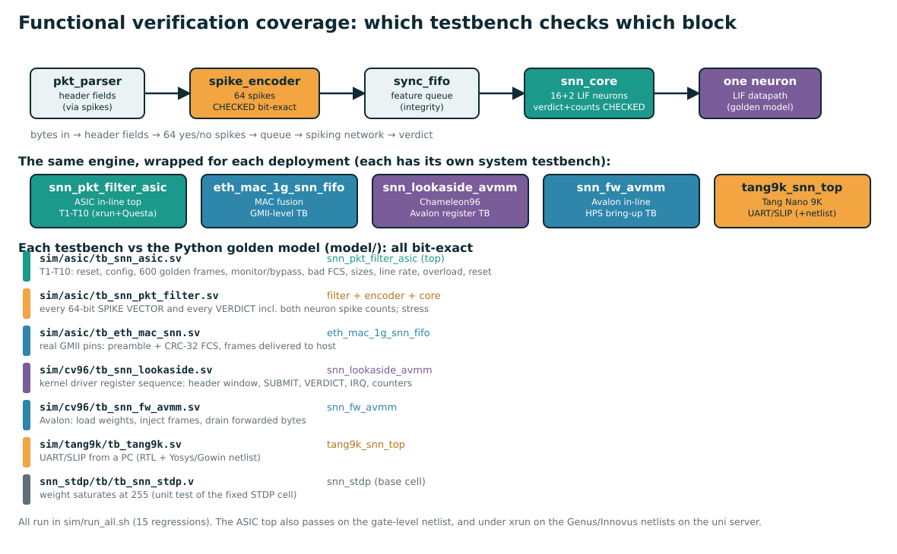

# Functional verification tables (all levels)

This is the complete set of functional-verification tables, from a single neuron up to the top-level chip. It
answers "how do we know each part works?" at every level of the hierarchy.

**About the xrun screenshot** (`docs/functional_verification.md`, `docs/img/xrun_rtl_waveform.png`): that waveform is
the **top-level module `snn_pkt_filter_asic`** (the whole in-line firewall) running tests T1–T10. It is **not** a
single neuron. The per-neuron and per-block tables are below; the top-level table is level 6.

Everything is checked against one reference, the **Python golden model** (`model/pktfeat.py`, `model/snn_int.py`),
which defines the correct output for every input. "Bit-exact" = the hardware's result is identical to the model's,
down to every bit. All tables are exercised by `sim/run_all.sh` (15 regressions).

## Coverage map: which testbench checks which block

The design is one engine (parser → encoder → FIFO → SNN core) wrapped five ways for the five deployments. Each block
and each wrapper has a table below.

---

## Level 1 — a single LIF neuron

**What it must do:** each time step, `v ← v − v/4 + I` (leak then integrate); if `v ≥ threshold`, emit a spike and
reset `v` to 0. Over 8 steps it emits a spike **count** (0–8) that grows with the input current `I`.

| # | scenario | input current I (relative to threshold 256) | expected over 8 steps | why it matters |
|---|---|---|---|---|
| N1 | **no input** | I = 0 | 0 spikes, v stays 0 | a silent neuron does nothing |
| N2 | **inhibited** | I < 0 (e.g. −100) | 0 spikes, v stays ≤ 0 | negative weights suppress firing |
| N3 | **weak input** | I = 120 (< threshold) | **2 spikes** (charge builds over 2–3 steps, then fires) | sub-threshold input still fires, slowly — this is the "leaky integrate" |
| N4 | **medium input** | I = 150 or 225 | **4 spikes** (fires every other step) | spike count encodes strength |
| N5 | **strong input** | I = 300 (> threshold) | **8 spikes** (fires every step) | saturates at the step count |
| N6 | **leak / decay** | input then silence | charge drops by 1/4 each step | the neuron forgets old input |
| N7 | **reset** | any step that fires | v returns to exactly 0 after a spike | hard reset, no residue |
| N8 | **saturation** (base `snn_stdp` cell) | repeated potentiation | weight stops at 255, never wraps | the bug fixed in `snn_stdp.v` |

**How verified.** The neuron's exact per-step membrane and spike behaviour is defined by `model/snn_int.py::infer`.
Because the two output neurons' spike counts (`out_cnt0`, `out_cnt1`) are checked bit-exact for all 600 test frames
(level 2), every neuron's integrate/leak/fire/reset is verified transitively — a wrong leak or threshold would change
a count. N8 (saturation) is a dedicated unit test: `snn_stdp/tb/tb_snn_stdp.v`, which fails the original cell
(wraps at 178) and passes the fixed one (saturates at 255). The numbers in N1–N5 are the real output of the hardware
arithmetic (`v - (v>>2) + I`, threshold 256).

---

## Level 2 — the spiking network (`snn_core`, 64 → 16 → 2)

**What it must do:** take 64 input spikes and the trained weights, run 16 hidden + 2 output LIF neurons for 8 time
steps, and output the two spike counts and the verdict (`malicious = cnt1 > cnt0`, tie broken by membrane).

| # | property | expected | how checked |
|---|---|---|---|
| C1 | **bit-exact verdict** | for all 600 frames, `out_mal` = golden model | `tb_snn_pkt_filter` compares `dut.c_mal` to `expected.txt` |
| C2 | **bit-exact spike counts** | `out_cnt0`, `out_cnt1` = golden model (0–8 each) | compares `dut.c_cnt0/c_cnt1` — this is what verifies the neurons |
| C3 | **decision rule** | malicious iff cnt1 > cnt0, or equal and v₂[1] > v₂[0] | covered by C1 across tie and non-tie cases |
| C4 | **event-driven input** | only the active (=1) inputs are visited to build the input current; an all-zero input is cheap | same verdicts regardless of how many inputs are 1 (C1 holds for sparse and dense frames) |
| C5 | **run-time weights** | loading new `W1/W2/B2` changes the output accordingly; reset does not clear W1 | T2 writes 276 weights and reads them back; verdicts then match the loaded network |
| C6 | **latency** | ≈ (active inputs) + 8 + 6 cycles per frame | timing of the pipelined adder tree; frames keep up at line rate (level 6, T8) |

Result on the shipped weights: 197/198 attacks flagged, 0 false alarms on 402 benign frames, 600/600 verdicts and
spike counts identical to the model.

---

## Level 3 — the feature encoder (`spike_encoder`)

**What it must do:** turn the parsed header fields into exactly the 64 binary features the network expects,
including the stateful 32-frame SYN/ping rate window.

| # | feature group (bits) | checked behaviour |
|---|---|---|
| E1 | L2/L3 type (1–4) | IPv4 / ARP / IPv6 / other set correctly from EtherType (+ one VLAN tag) |
| E2 | L4 protocol (5–8) | TCP / UDP / ICMP / other from the IP protocol byte |
| E3 | header shape (9–14) | IHL class, DF/MF/fragment-offset flags |
| E4 | TTL & length buckets (15–23) | correct bucket for TTL and IP total length |
| E5 | anomalies (24–26) | land (src=dst), bogon source, broadcast destination |
| E6 | TCP flags & ports (27–47) | the 6 flags + NULL, port classes, data offset, window class |
| E7 | ICMP & payload (48–56) | ICMP type, payload-length buckets, length inconsistency |
| E8 | **stateful rate (57–60)** | ≥ 8 / ≥ 16 SYNs or pings among the **last 32 frames** |
| E9 | truncation & services (61–63) | truncated header, sensitive port (22/23/445/3389), DNS |

**How verified.** `tb_snn_pkt_filter` checks the **entire 64-bit spike vector** (`dut.u_cls.spikes`) against
`expected.txt` for every frame (`spikes !== exp_spk` → error). Since the 600 frames exercise all 14 attack families
plus benign traffic, every feature group is driven both ways. The stateful window (E8) is verified because the
frames are a time-ordered stream and the flood episodes turn those bits on at the right frame.

---

## Level 4 — the header parser (`pkt_parser`)

**What it must do:** extract the header fields (EtherType, IHL, total length, flags, TTL, protocol, addresses, ports,
TCP flags, data offset, window) from the byte stream, handling one VLAN tag and IPv4 options, and clear all fields at
the start of each frame.

| # | property | expected |
|---|---|---|
| P1 | field extraction | every field matches `model/pktfeat.py::parse` |
| P2 | VLAN + IP options | correct L3/L4 offsets with a VLAN tag and IHL > 5 |
| P3 | truncated frames | missing fields read as 0 (same as the model) |
| P4 | per-frame reset | fields cleared on the first beat of each frame (no bleed-over) |

**How verified.** The parser feeds the encoder, so any parse error changes the 64-bit spike vector, which level 3
checks exactly. The 600 frames include VLAN, IPv4-options, fragmented and truncated frames, so P1–P4 are all
exercised. (There is no separate parser-only testbench; it is verified in composition.)

---

## Level 5 — the shared classifier engine (`snn_classifier`)

**What it must do:** glue the parser, encoder, feature FIFO and core into one block with a config/status bus, and
produce one verdict per committed frame, in order.

| # | property | expected | checked by |
|---|---|---|---|
| G1 | config bus | write/read-back of TH1, TH2, TIMING, B2, W2 (W1 write-only) | T2 |
| G2 | one verdict per frame, in order | verdicts come out in arrival order, one per committed frame | T3, C1 |
| G3 | sideband | `frm_commit` / `frm_len_ovr` / `frm_len` / `frm_tag` handled (in-line vs look-aside) | look-aside TB uses the length override |
| G4 | back-pressure | `can_commit` stalls commit when the feature FIFO is full, never corrupting | stress mode |

---

## Level 6 — the top-level ASIC module (`snn_pkt_filter_asic`)

**This is the module in the xrun screenshot.** The full in-line firewall: 2 KiB packet buffer, commit/rollback,
forward/drop, config/status, counters. Ten tests, all PASS on RTL (xrun + Questa) and on the sky130 gate-level
netlist. The full table with expected waveforms is in `docs/functional_verification.md`; summary:

| test | situation | PASS criterion |
|---|---|---|
| T1 | power-on reset | safe state: blocking on, defaults, counters 0, never stalls the MAC |
| T2 | config load / read-back | registers hold what was written |
| T3 | 600 golden frames (drop mode) | every verdict + forwarded byte = golden model; counters balance |
| T4 | monitor mode (CTRL=0) | classify + count, forward everything |
| T5 | bypass (CTRL.bypass) | forward everything |
| T6 | bad-FCS frames (tuser) | dropped whole, counted, no verdict |
| T7 | oversize / runt / 1518 B | oversize dropped whole; tiny & max-size pass intact |
| T8 | line-rate burst | no drops at 1 Gb/s with minimum frames |
| T9 | overload | whole-frame drops only, no corruption/reorder, counters add up |
| T10 | reset mid-traffic | clean abort + recovery, counters 0, then bit-exact |

---

## Level 7 — the deployment wrappers (system tests)

The same engine, wrapped and tested at the real interface of each target.

| module | deployment | testbench | what it adds over levels 1–6 |
|---|---|---|---|
| `eth_mac_1g_snn_fifo` | ASIC, fused into a 1G MAC | `tb_eth_mac_snn.sv` | driven at the **GMII pins**: preamble, CRC-32 FCS check/strip, clock-domain crossing to the host FIFO |
| `snn_lookaside_avmm` | Chameleon96 (Linux) | `tb_snn_lookaside.sv` | the **kernel driver's exact register sequence**: poll STATUS, write ≤128-byte header window, SUBMIT {tag,n,len}, poll VERDICT, IRQ, counters |
| `snn_fw_avmm` | Cyclone V bring-up | `tb_snn_fw_avmm.sv` | Avalon-MM: load weights, inject frames byte-wise (TX_WORD/TX_BYTE), drain forwarded bytes (RX_POP) |
| `tang9k_snn_top` | Tang Nano 9K | `tb_tang9k.sv` | a PC over **UART + SLIP**; verified on RTL **and** the Yosys/Gowin post-synthesis netlist |

Each produces `RESULT: PASS` with verdicts bit-exact to the golden model. The Chameleon96 wrapper was additionally
confirmed on the **real FPGA** (`snn_test`, 10/10, 600/600 bit-exact — `docs/board_test_cv96.md`).

---

## Level 8 — the Cadence ASIC flow (equivalence + gate-level)

Beyond RTL simulation, the ASIC flow proves the synthesized and placed-and-routed netlists still match the RTL:

| step | tool | what it proves |
|---|---|---|
| gate-level sim (zero delay) | xrun on the Genus `tm_netlist` | the synthesized gates reproduce T1–T10 |
| equivalence (LEC) | Conformal | the netlist is logically equivalent to the RTL (all compare points equivalent) |
| post-route sim (SDF) | xrun on the Innovus netlist + delays | the placed-and-routed chip still passes T1–T10 with real timing |

Commands and expected output: `asic/README.md`, `docs/functional_verification.md`, `docs/verification_guide.md`.

---

## Summary

| level | block | verified | evidence |
|---|---|---|---|
| 1 | one LIF neuron | integrate/leak/fire/reset, spike count | via output counts (C2) + `tb_snn_stdp` |
| 2 | SNN core (64→16→2) | verdict + both spike counts, bit-exact | `tb_snn_pkt_filter` (600 frames) |
| 3 | spike encoder | all 64 features incl. stateful rate | 64-bit spike vector checked (600 frames) |
| 4 | pkt_parser | field extraction, VLAN/options/truncation | in composition (changes the spikes) |
| 5 | classifier engine | config bus, in-order verdicts | T2, T3, stress |
| 6 | **snn_pkt_filter_asic (top)** | buffer, drop/forward, counters | **T1–T10, xrun + Questa + sky130 gates** |
| 7 | 4 deployment wrappers | GMII / Avalon / UART interfaces | 4 system testbenches + the real board |
| 8 | Cadence netlists | synthesis & P&R preserve behaviour | GLS + LEC + SDF |

Related: `docs/functional_verification.md` (the T1–T10 table in full), `docs/simulation_explained.md` (the vectors
and the waveform), `docs/neuron_hdl.md` (the hardware), `docs/training.md` (where the weights come from).
